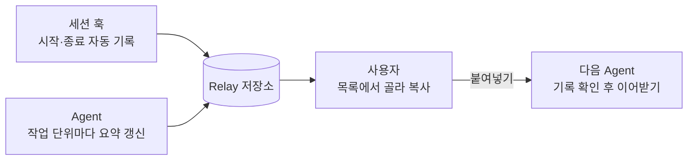

# Relay

**AI Agent 세션을 기록하고, 다음 Agent가 이전 작업을 찾아갈 수 있게 연결하는 Windows용 로컬 CLI입니다.**

Codex로 작업하다 Claude Code나 Grok으로 옮기거나 새 대화를 열면, 새 Agent는 이전 세션이 어디서 무엇을 했는지부터 찾아야 합니다. Relay는 각 세션의 실제 세션 ID, 도구, 프로젝트 경로, 짧은 작업 요약을 로컬 SQLite에 남기고, 그 기록을 다음 Agent에게 한 줄 명령으로 넘겨줍니다.



Relay는 찾아갈 단서만 전달하고, 내용 파악은 Agent가 실제 프로젝트 파일을 보고 합니다. 전체 대화 보관, 원본 로그 수집, 실행 중인 Agent 전환, 대화 자동 재개는 제공하지 않습니다.

## 목차

- [주요 기능](#주요-기능)
- [용어](#용어)
- [설치](#설치)
- [사용 방법](#사용-방법)
- [Agent 연동](#agent-연동)
- [명령](#명령)
- [터미널과 브라우저 화면](#터미널과-브라우저-화면)
- [데이터와 설정](#데이터와-설정)
- [문제 해결](#문제-해결)
- [API](#api)

## 주요 기능

- **자동 첫 기록**: Claude Code, Codex, Grok, Cursor의 SessionStart 훅이 세션 시작 시 식별 정보를 기록합니다.
- **종료 기록**: SessionEnd 훅이 종료 시각과 사유를 남깁니다. 훅 자동 기록만 남은 채 끝난 세션은 목록만 차지하므로 지웁니다.
- **압축 대응**: PreCompact 훅이 컨텍스트 압축 횟수와 시각을 남기고, 압축 뒤 다시 시작하는 세션에는 Relay 기록을 다시 읽고 보완하라는 안내를 넣어 줍니다.
- **모델 기록**: 훅이 도구가 알려 준 모델과 대화 기록에 남은 응답 모델을 세션의 모델 목록에 씁니다. 세션 중에 모델을 바꾸면 `claude-opus-5-5, claude-fable-5-1`처럼 처음 쓴 순서대로 쌓이며, Agent가 따로 기록하지 않아 토큰이 들지 않습니다.
- **조회**: 출처별 최근 세션, 프로젝트별 조회, 이름·ID·요약·경로 부분 검색을 지원합니다.
- **세션 연결**: `continue`로 이전 세션과 현재 세션의 부모·자식 관계를 남깁니다.
- **작업 상태와 고정**: Agent가 `--status`로 남긴 마지막 작업 상태(작업 중·막힘·인계 대기·완료)를 목록·상세·이력에 표시하고 필터합니다. `pin`으로 고정한 세션은 보관 기간과 종료 정리에서 제외됩니다.
- **Git 단서**: CLI로 기록할 때 브랜치, 짧은 커밋 해시, 수정 파일 수를 함께 저장합니다. diff는 저장하지 않습니다.
- **세션 흐름**: `chain`과 브라우저의 세션 연결 탭에서 처음 세션부터 이어받은 세션까지 전체 흐름을 봅니다.
- **인계 문서와 재개 명령**: `handoff`와 `인계 문서 복사`로 요약·이력·흐름·명령을 담은 Markdown을 만들고, `claude --resume` 같은 원본 도구의 재개 명령을 바로 복사합니다.
- **터미널 선택 화면**: 표에서 행을 고르면 상세를 확인하고, 다음 대화에 붙여넣을 조회 명령을 복사합니다.
- **브라우저 조회**: 필터, 상세, 요약 이력, 세션 연결을 `127.0.0.1`에서 확인합니다. macOS 데스크톱 모양의 화면이며 설정 창에서 테마·글자 크기·바탕화면을 바꿉니다.
- **백그라운드 서버**: `relay web --headless`로 띄운 서버는 터미널을 닫아도 유지되고, `relay web --close`로 종료합니다.
- **설치형 앱**: Chrome·Edge에서 앱으로 설치하면 브라우저 탭 없이 별도 창으로 열고 작업 표시줄·시작 메뉴에서 바로 실행합니다. 서버가 꺼져 있어도 창은 열리고, 서버를 켜면 저절로 다시 연결됩니다.
- **30일 보관**: 마지막 갱신 기준 30일이 지난 기록은 자동 정리됩니다.

## 용어

| 용어 | 설명 |
| --- | --- |
| **Agent Session ID** | Claude Code, Codex, Grok이 각자 발급하는 36자 UUID입니다. Relay는 이 값을 그대로 저장하고 CLI 조회에 씁니다. JSON 필드는 `providerSessionId`입니다. |
| **Relay 내부 ID** | `ses_`로 시작하는 Relay 저장소 식별자입니다. 웹 API와 부모·자식 연결에만 쓰며, CLI 조회에 넣으면 올바른 `relay show` 명령을 안내합니다. JSON 필드는 `id`입니다. |
| **provider / agent** | 회사 식별자와 도구 식별자입니다. `openai`/`codex`, `anthropic`/`claude-code`, `xai`/`grok`, `cursor`/`cursor-agent`. |
| **출처 별칭** | `codex`, `claude`, `grok`, `cursor`. 조회할 **이전 작업의 출처**를 한 단어로 가리키며, 현재 Agent를 바꾸는 옵션이 아닙니다. |
| **훅 자동 기록** | 시작 훅이 만든 첫 기록입니다. 세션 이름은 작업 폴더명, 요약은 `세션 첫 기록 (훅 자동 기록)`이며 실제 단서는 Agent가 `update`로 채웁니다. |
| **세션 연결** | `continue`가 남기는 부모·자식 관계입니다. 이전 세션이 부모, 이어받은 세션이 자식입니다. |
| **종료 기록** | 종료 훅이 남기는 `endedAt`과 `endReason`입니다. 없으면 `진행 중`으로 표시되지만, 강제 종료된 세션도 훅이 돌지 않아 `진행 중`으로 남을 수 있습니다. 브라우저는 종료 기록 없이 6시간 넘게 갱신이 없으면 `응답 없음`으로 표시합니다. |
| **작업 상태** | Agent가 `--status`로 마지막에 선언한 상태입니다. `working`(작업 중) · `blocked`(막힘) · `handoff`(인계 대기) · `done`(완료). 프로세스의 실행 여부가 아니며 다음 `--status`까지 유지됩니다. JSON 필드는 `status`입니다. |
| **고정** | `relay pin`으로 표시한 세션입니다. 보관 기간 자동 삭제와 훅 종료 정리에서 제외되며 JSON 필드는 `pinned`입니다. |
| **Git 단서** | CLI로 기록한 시점의 브랜치·짧은 커밋 해시·수정 파일 수입니다. JSON 필드는 `git`이며 저장소 밖이면 `null`입니다. |
| **압축 기록** | PreCompact 훅이 남기는 컨텍스트 압축 횟수·마지막 시각·계기입니다. JSON 필드는 `compaction`이며, 있으면 압축 전 대화의 세부가 기록에 없을 수 있다는 뜻입니다. |
| **모델** | 세션이 쓴 모델을 처음 쓴 순서대로 쉼표로 이은 목록입니다(예: `claude-opus-5-5, claude-fable-5-1`). 훅이 채우며 JSON 필드는 `model`입니다. Claude Code는 시작할 때 모델을 알려 주지 않으므로, 모델을 바꾸거나 압축·종료하기 전까지는 `미기록`으로 보일 수 있습니다. |

## 설치

Windows 10/11 x64를 지원합니다. `relay.exe` 하나에 런타임과 웹 화면이 들어 있어 설치 후에는 Node.js, Bun, 관리자 권한이 필요 없습니다.

### 빌드하고 설치하기

소스에서 빌드하려면 Node.js 22.12 이상과 npm이 필요합니다. Bun은 npm 의존성으로 함께 설치됩니다.

```powershell
npm ci
npm run build
.\scripts\install-cli.ps1
```

설치 스크립트는 `dist\relay.exe`를 `%USERPROFILE%\.local\bin\relay.exe`에 복사하고, 그 폴더를 사용자 PATH에 추가한 뒤 `relay install-hooks`로 네 도구(Claude Code·Codex·Grok·Cursor)의 SessionStart·SessionEnd·PreCompact 훅(Claude Code는 PostModelSwitch 포함)을 등록하고 `relay install-skills`로 `relay-session` 스킬을 Claude Code·Grok·Codex의 사용자 스킬 폴더에 둡니다. 이미 빌드된 실행 파일이 있다면 설치 스크립트만 실행하면 됩니다.

```powershell
relay --version
relay --help
```

`relay`를 찾지 못하면 새 터미널을 여세요. **Codex는 등록된 훅을 `/hooks`에서 한 번 신뢰해야 실행됩니다.** Claude Code와 Grok은 추가 조작이 필요 없습니다.

### 업데이트와 제거

다시 빌드하고 덮어씁니다. 설치한 `relay.exe`로 `relay web` 서버나 터미널 선택 화면이 떠 있어도 그대로 실행하면 됩니다. Windows는 실행 중인 파일을 덮어쓸 수 없으므로 설치 스크립트가 옛 파일을 `relay.exe.<시각>.old`로 옮기고 새 파일을 넣은 뒤, 옛 파일로 떠 있던 웹 서버를 같은 포트·저장소로 `relay web --reload` 해 새 버전으로 바꿉니다. 열린 화면은 새 버전을 알아채고 스스로 새로 고칩니다. 옮긴 옛 파일은 그 프로세스가 끝나면 지워지고, 아직 쓰는 중이면(터미널 선택 화면 등) 다음 설치 때 지워집니다.

```powershell
npm run build
.\scripts\install-cli.ps1 -Force
```

설치 위치는 `-InstallDirectory <절대경로>`, PATH 등록 생략은 `-NoPath`로 지정합니다. `-Force`는 실행 파일과 함께 내용이 바뀐 스킬 사본도 교체합니다. 제거하려면 설치된 `relay.exe`와 같은 폴더의 `relay-hook-*.cmd`를 삭제하고 각 도구의 훅 설정에서 Relay 항목을 지운 뒤, 각 도구의 사용자 스킬 폴더에서 `relay-session`을 삭제합니다. 데이터까지 지우려면 [저장소 폴더](#데이터와-설정)를 삭제합니다.

## 사용 방법

사용자가 하는 일은 세 가지입니다. 훅이 세션을 자동 기록하게 두고, Agent가 요약을 남기게 하고, 목록에서 골라 다음 Agent에게 건넵니다.

### 자동 기록

설치하면 세션 훅이 등록됩니다. 세션을 열면 시작 훅이 세션 ID와 작업 폴더를 기록하고, 세션을 닫으면 종료 훅이 종료 시각과 사유를 남깁니다. 훅은 세션 ID만 알고 작업 내용은 모르므로 요약은 `세션 첫 기록 (훅 자동 기록)`으로 시작하며, 실제 단서는 Agent가 채웁니다.

### 기록 갱신

Agent가 의미 있는 작업 단위마다 요약을 갱신합니다. 프로젝트에 스킬과 지침을 넣어 두면 Agent가 스스로 수행하며, 방법은 [Agent 연동](#agent-연동)에 있습니다. Codex 환경의 PowerShell 예시입니다.

```powershell
relay show $env:CODEX_THREAD_ID --provider openai --json
relay record --provider openai --agent codex --session-id $env:CODEX_THREAD_ID --session-name "로그인 리다이렉트 수정" --summary "로그인 콜백의 리다이렉트 동작 확인 중"
relay update --session-id $env:CODEX_THREAD_ID --provider openai --session-name "로그인 리다이렉트 수정" --status handoff --summary "auth/callback.ts 수정, 테스트 통과. 모바일 확인 필요"
```

- `record`는 `show`로 확인해 기록이 없을 때만 씁니다. 훅이 먼저 기록해 두었으면 바로 `update`를 씁니다.
- `--session-name`은 훅이 폴더명으로 적어 둔 이름을 작업 주제로 바꿉니다. `--status working|blocked|handoff|done`은 마지막 작업 상태이며 다음 `--status`까지 유지되고 이력에도 남습니다. 막히면 `blocked`, 남은 일을 다음 세션에 넘기면 `handoff`, 끝났으면 `done`입니다.
- Git 저장소 안에서 `record`·`update`·`continue`를 실행하면 브랜치·짧은 커밋 해시·수정 파일 수가 단서로 함께 저장됩니다. diff는 저장하지 않으며 `RELAY_NO_GIT=1`이면 생략합니다. 훅 자동 기록은 시간 제한 때문에 Git을 읽지 않습니다.
- `record`는 같은 첫 입력을 재시도해도 이력이 중복되지 않지만, `update`는 호출마다 이력을 추가합니다.
- 요약은 목표, 현재 상태, 변경 파일, 검증 결과, 다음 작업처럼 다음 Agent가 바로 쓸 사실만 짧게 씁니다. 전체 채팅, 파일 전문, 비밀정보는 넣지 않습니다.
- **`update`를 한 번도 남기지 않은 세션은 종료 시 삭제됩니다.** 남길 세션은 첫 작업 단위가 끝나면 반드시 갱신하세요.

### 건네주기

```powershell
relay list
relay --codex
```

`relay list`는 표에서 세션을 골라 상세를 보고, `Enter`로 이어받기 안내를 복사합니다. `relay --codex`처럼 출처를 지정하면 그 출처의 최근 세션 상세가 바로 열립니다. 브라우저의 `세션 컨텍스트 복사`도 같은 문장을 만듭니다. 복사되는 문장은 다음과 같습니다(Claude Code 세션의 예).

```text
이전 Claude Code 세션을 이어서 작업해 주세요.
`relay-session` 스킬의 continue 절차로 현재 세션을 연결하고, 아래 순서로 원본 대화와 실제 파일을 확인한 뒤 작업하세요.
작업 경로: <작업 경로>

1. Relay 기록으로 원본 세션의 도구·세션 ID·작업 경로를 확인하세요.
   `relay show '<Agent Session ID>' --provider '<provider>' --data-dir '<Relay 저장소>' --history --json`
   Relay 요약은 줄여 쓴 참고용이라 요구사항이 빠졌을 수 있으니 작업 기준으로 삼지 마세요.

2. 원본 세션에 들어가 실제 대화를 읽으세요.
   `resume-claude` 스킬이 있으면 그것으로 세션 `<Agent Session ID>`를 열고, 없으면 대화 기록을 직접 읽으세요.
   `~/.claude/projects/<작업 경로를 바꾼 폴더>/<Agent Session ID>.jsonl`
   (CLAUDE_CONFIG_DIR를 쓰면 그 아래 projects. 경로가 다르면 세션 ID로 찾으세요.)

3. 원본 대화에서 사용자 요구사항을 원문대로 확인하고, 실제 파일과 작업 트리로 진행 상황과 남은 작업을 파악하세요.

원본 대화를 찾지 못하면 먼저 알리고 사용자 확인을 받으세요. 현재 사용자 요청과 프로젝트 지침이 우선이며, 확인하지 못한 내용은 추측하지 마세요.
```

Relay에 남는 요약은 앞선 Agent가 줄여 쓴 메모라, 그것만 넘기면 요구사항이 축약됩니다. 그래서 이 문장은 Relay 기록을 원본 세션을 찾는 색인으로만 쓰게 하고, 받는 Agent가 원본 세션(실제 대화 기록)에 직접 들어가 요구사항을 원문대로 확인한 뒤 이어서 작업하게 합니다. 원본 대화는 도구별 세션 읽기 스킬(`resume-claude`·`resume-codex`·`resume-cursor`)이 있으면 그것으로, 없으면 대화 기록 파일로 엽니다. Claude Code는 `~/.claude/projects/<작업 경로의 영문·숫자 밖 글자를 -로 바꾼 폴더>/<ID>.jsonl`, Codex는 `~/.codex/sessions/<년>/<월>/<일>/rollout-*-<ID>.jsonl`, Grok은 `~/.grok/sessions/<인코딩한 작업 경로>/<ID>/chat_history.jsonl`이며, 문장에는 그 세션의 도구에 맞는 위치만 들어갑니다. 받는 Agent는 같은 PC에서 `relay`와 해당 저장소, 원본 대화 기록에 접근할 수 있어야 합니다. 메모장에서도 읽히도록 단계마다 문단을 나눈 여러 줄 글이며, Claude Code·Codex 같은 CLI는 여러 줄 붙여넣기를 한 번에 받습니다(세션 값에 섞인 줄바꿈은 공백으로 접습니다).

`relay`가 없는 곳(웹 챗, 다른 PC)에 넘기려면 `relay handoff <Agent Session ID> --provider <provider>`가 출력하는 Markdown 인계 문서를 붙여넣습니다. 요약, 최근 이력, 세션 흐름, 조회 명령, 원본 세션 재개 명령이 들어 있으며 브라우저 상세의 `인계 문서 복사`도 같은 문서를 만듭니다. 원본 대화를 그 도구에서 다시 열려면 `원본 세션 재개 명령 복사`를 씁니다(`claude --resume`, `codex resume`, `grok --resume`).

### 이어받기

이전 작업을 **파악하는 요청**과 **이어서 수행하는 요청**은 구분하세요. 붙여넣은 문장만으로는 조회만 하며, "이 기록을 확인하고 작업을 이어서 해 주세요"처럼 요청하면 Agent가 `continue`로 현재 세션을 이전 세션의 자식으로 연결한 뒤 프로젝트 파일을 확인하고 작업을 계속합니다. Grok 세션을 Codex가 이어받는 예시입니다.

```powershell
relay continue '<이전 Agent Session ID>' --parent-provider xai --provider openai --agent codex --session-id $env:CODEX_THREAD_ID --summary "이전 로그인 수정 세션을 확인함. 모바일 동작 검증 진행"
```

- `--parent-provider`는 이전 세션의 제공자, `--provider`는 현재 세션의 제공자입니다.
- 이어받을 때는 별도로 `record`하지 않고 `continue`를 먼저 호출합니다. 훅이 현재 세션을 이미 기록해 두었어도 부모가 없으면 그 기록에 연결됩니다.
- `continue`는 Relay 기록 사이의 연결만 남기며 원본 대화를 재개하지 않습니다. 새 기록은 부모의 세션 이름과 프로젝트 경로를 기본으로 쓰고, 다른 폴더면 `--cwd`를 지정합니다.
- 이미 다른 부모에 연결돼 있거나 자기 자신·자손을 부모로 지정하면 `PARENT_CONFLICT`입니다.

## Agent 연동

CLI 설치 또는 `relay install-hooks`로 스킬·세션 훅·시작 안내를 함께 구성합니다. Claude Code·Codex는 시작 훅으로, Grok은 자동 로드되는 사용자 규칙으로 안내를 받으므로 프로젝트마다 같은 프롬프트를 넣을 필요가 없습니다. 프로젝트별 추가 지침은 `AGENTS.md`에 둡니다.

### 스킬 설치

[skills/relay-session](skills/relay-session/SKILL.md)은 Agent가 Relay를 기록·조회·이어받는 절차를 담은 스킬입니다. `relay install-skills`가 이 스킬을 세 도구의 사용자 스킬 폴더에 실제 사본으로 설치하므로 모든 프로젝트에서 바로 쓸 수 있습니다. `install-cli.ps1`이 설치 끝에 한 번 실행하며, 스킬이 바뀐 뒤에는 직접 실행합니다.

```powershell
relay install-skills
relay install-skills --force
```

| 도구 | 설치 위치 | 비고 |
| --- | --- | --- |
| Claude Code | `~/.claude/skills/relay-session` | `argument-hint` 포함 |
| Grok | `$GROK_HOME/skills/relay-session` (기본 `~/.grok/skills/relay-session`) | `argument-hint` 포함 |
| Codex | `~/.codex/skills/relay-session` (`CODEX_HOME`이 설정돼 있으면 그 폴더에도) | `agents/openai.yaml` 포함 |
| Cursor | 별도 사본 없음 | Cursor가 `~/.claude/skills`와 `~/.codex/skills`를 함께 읽으므로 위 사본을 그대로 씁니다 |

스킬 폴더는 심볼릭 링크나 정션으로 연결하지 않습니다. 링크는 가리키던 폴더가 옮겨지거나 지워지면 끊어지고, 그러면 Agent가 "심볼릭 링크 문제로 스킬을 못 쓴다"고 보고합니다. `install-skills`는 설치 위치에 링크가 있으면 링크 항목만 지우고 실제 사본으로 바꾸며, 링크가 가리키던 폴더는 건드리지 않습니다. 기존 사본의 내용이 다르면 덮어쓰지 않고 `건너뜀`으로 알리므로 확인한 뒤 `--force`로 교체합니다. Claude Code는 `~/.agents/skills`를 읽지 않으므로 그 폴더에 복사하거나 연결하는 방식은 쓰지 않습니다.

특정 프로젝트에만 두려면 설치 스크립트를 사용합니다. 기존 파일 내용이 다르면 덮어쓰지 않고 중단하며, 설치 위치가 링크이면 실제 사본으로 바꿉니다.

```powershell
.\scripts\install-skill.ps1 -Agent codex -ProjectDirectory "C:\workspace\my-project"
.\scripts\install-skill.ps1 -Agent claude -ProjectDirectory "C:\workspace\my-project"
.\scripts\install-skill.ps1 -Agent grok -ProjectDirectory "C:\workspace\my-project"
```

각각 `.agents/skills/relay-session`, `.claude/skills/relay-session`, `.grok/skills/relay-session`에 배치됩니다. 프로젝트 사본은 사용자 스킬보다 우선하므로 스킬을 갱신하면 프로젝트 사본도 다시 설치합니다. 스킬을 인식한 Codex에서는 `$relay-session grok`, Claude Code와 Grok에서는 `/relay-session grok`으로 Grok 기록을 조회할 수 있습니다.

### 프로젝트 지침

프로젝트의 `AGENTS.md` 또는 `CLAUDE.md`에 아래 지침을 추가하면 Agent가 첫 작업 전에 기록 절차를 수행합니다. 이 저장소의 [AGENTS.md](AGENTS.md)가 실제 예시입니다.

```text
세션의 첫 작업 전에 relay-session 스킬을 읽고, 그 절차에 따라 현재 세션 정보를 Relay에 기록한다.
명령을 추측하지 않는다. 스킬을 찾지 못하거나 링크 문제로 읽히지 않으면 relay --help로 확인하고, relay install-skills로 다시 설치하라고 한 줄로 알린다.
호스트가 제공한 실제 세션 ID만 사용하고, 기존 기록을 먼저 확인해 없을 때만 생성한다.
이전 작업을 이어받으면 continue로 출처를 연결하고, 작업 단위가 끝나면 짧은 진행 단서를 갱신한다.
중간 작업 내용 또한 Relay 도구로 기록해 목표·현재 상태·변경 파일·검증 결과·남은 위험이나 다음 작업을 짧게 남긴다.
update를 한 번도 남기지 않은 세션 기록은 종료 시 삭제되므로 첫 작업 단위가 끝나면 반드시 갱신한다.
relay가 없거나 기록에 실패하면 한 줄로 알리고 원래 작업을 계속한다.
```

세션 ID는 각 도구가 환경변수로 제공합니다. Agent는 이 값을 그대로 쓰고 임의로 만들지 않습니다.

| 도구 | 환경변수 | `--provider` / `--agent` |
| --- | --- | --- |
| Claude Code | `CLAUDE_CODE_SESSION_ID` | `anthropic` / `claude-code` |
| Codex | `CODEX_THREAD_ID` | `openai` / `codex` |
| Grok | `GROK_SESSION_ID` | `xai` / `grok` |
| Cursor | 없음. `sessionStart` 훅이 맥락에 넣어 주는 `sessionId`(`conversation_id`) 사용 | `cursor` / `cursor-agent` |

### 시작·종료 훅

`relay install-hooks`가 네 도구의 SessionStart·SessionEnd·PreCompact 훅과 Claude Code의 PostModelSwitch 훅, 시작 안내와 `relay-session` 스킬을 함께 설치합니다. `install-cli.ps1`도 이 명령을 호출하므로 CLI 설치 때 자동으로 적용됩니다. `relay.exe`를 실행할 때마다 빠진 훅과 Grok 시작 안내를 다시 채웁니다. 기존의 다른 훅은 유지하고, Relay 항목이 이미 있으면 실행 파일 경로와 제한 시간만 맞춥니다.

| 도구 | 훅 위치 | 시작 명령 | 종료 명령 | 압축 명령 |
| --- | --- | --- | --- | --- |
| Claude Code | 사용자 설정 `hooks.SessionStart` · `SessionEnd` · `PreCompact` · `PostModelSwitch` | `relay.exe hook claude` | `relay.exe hook claude --end` | `relay.exe hook claude --compact` (모델 전환: `relay.exe hook claude --model-switch`) |
| Codex | `~/.codex/hooks.json` (`CODEX_HOME`이 설정돼 있으면 그 폴더에도) | `relay-hook-codex.cmd` | `relay-hook-codex-end.cmd` | `relay-hook-codex-compact.cmd` |
| Grok | `$GROK_HOME/hooks/relay.json` (기본 `~/.grok/hooks/relay.json`) | `relay-hook-grok.cmd` | `relay-hook-grok-end.cmd` | `relay-hook-grok-compact.cmd` |
| Cursor | `~/.cursor/hooks.json`의 `sessionStart` · `sessionEnd` · `preCompact` | `relay-hook-cursor.cmd` | `relay-hook-cursor-end.cmd` | `relay-hook-cursor-compact.cmd` |

Claude Code 설정 예시입니다. Codex와 Grok은 같은 구조에 래퍼 `.cmd` 경로를 넣습니다.

```json
{
  "hooks": {
    "SessionStart": [
      { "hooks": [{ "type": "command", "command": "\"C:/Users/<사용자>/.local/bin/relay.exe\" hook claude || echo {}", "timeout": 10 }] }
    ],
    "SessionEnd": [
      { "hooks": [{ "type": "command", "command": "\"C:/Users/<사용자>/.local/bin/relay.exe\" hook claude --end || echo {}", "timeout": 10 }] }
    ]
  }
}
```

- Codex·Claude Code의 시작 훅은 `hookSpecificOutput.additionalContext`로 위 프로젝트 지침에 해당하는 안내를 Agent에게 전달합니다. 스킬 읽기, `relay --help` 확인, 기존 기록 조회, `continue` 연결, 중간 진행 요약과 실패 시 작업 계속을 안내하며, 호스트가 제공한 실제 세션 ID와 provider/agent도 함께 전달합니다. 시작·재개 시 Agent의 맥락에 추가되는 안내이며 채팅창에 사용자 메시지로 입력되지는 않습니다.
- Grok은 SessionStart 출력을 무시하므로 같은 안내를 `$GROK_HOME/rules/relay-session.md`(기본 `~/.grok/rules/relay-session.md`)에 설치합니다. Grok이 세션 시작 때 자동으로 읽는 [사용자 전역 규칙](https://github.com/xai-org/grok-build/blob/main/crates/codegen/xai-grok-pager/docs/user-guide/12-project-rules.md#rules-directories)이며 실제 ID는 현재 호스트의 `GROK_SESSION_ID`를 사용합니다. 설치 결과에 안내 파일 경로와 상태가 표시됩니다. 반복 등록해도 중복되지 않고, Relay가 관리하는 사본만 갱신합니다. 같은 경로의 사용자 파일이나 링크는 덮어쓰지 않고 `건너뜀`으로 알립니다. 응답 형식과 제한은 [Codex 훅 문서](https://learn.chatgpt.com/docs/hooks#sessionstart), [Claude Code 훅 문서](https://code.claude.com/docs/en/hooks#sessionstart), [Grok 훅 문서](https://github.com/xai-org/grok-build/blob/main/crates/codegen/xai-grok-pager/docs/user-guide/10-hooks.md#output-passive-hooks)를 기준으로 합니다.
- Cursor의 `sessionStart` 훅은 같은 안내를 Cursor가 읽는 `additional_context`로 돌려주고, 세션 ID는 페이로드의 `conversation_id`(Cursor CLI가 `agent --resume`에 쓰는 chat id)를 씁니다. 작업 경로는 `workspace_roots`의 첫 항목입니다. 설정 형식은 [Cursor 훅 문서](https://cursor.com/docs/agent/hooks)를 따릅니다.
- 모든 훅은 세션의 모델 목록(`model`)도 채웁니다. 페이로드의 `model`(Codex·Cursor는 모든 이벤트에 있음)과 Claude Code `PostModelSwitch`의 `to_model`, 그리고 `transcript_path` 대화 기록에서 실제로 응답한 모델(Claude Code는 본 대화 응답의 `message.model`, Codex는 `turn_context`의 `model`)을 처음 쓴 순서대로 더합니다. 서브에이전트 응답과 Claude Code가 스스로 만든 `<synthetic>` 응답은 빼며, 요약·갱신 시각·이력은 건드리지 않습니다. 모델 전환 훅은 `{}`를 돌려주므로 Agent 맥락에 아무것도 더하지 않습니다.
- 호스트가 컨텍스트를 압축하면 `PreCompact` 훅이 세션의 `compaction`(횟수·마지막 시각·계기)만 갱신하고 `{}`를 돌려줍니다. Claude Code와 Codex는 압축 뒤 `source: compact`로 시작 훅을 다시 부르는데, 이때는 첫 기록 안내 대신 `relay show --history`로 기록을 다시 읽고 `update`로 보완하라는 안내를 넣습니다. Grok은 같은 안내를 시작 규칙 파일에서 읽습니다.
- 훅은 저장소를 열기 전에 JSON 응답 한 건을 출력하고 기록을 시도합니다. 종료 훅·압축 훅·Grok 시작 훅·사용할 수 없는 입력은 `{}`를 반환하며, 기록 오류가 도구의 세션을 막지 않습니다.
- 세션 ID는 페이로드의 `session_id`, `sessionId`, `thread_id`, 그다음 해당 도구의 환경변수 순으로 찾습니다. 다른 도구의 환경변수는 사용하지 않으며, 서브에이전트 페이로드(`agent_id`, `subagentType`, `subagent_type`)는 기록하거나 안내하지 않습니다.
- 시작 훅은 작업 폴더 이름과 `세션 첫 기록 (훅 자동 기록)` 요약으로 등록합니다. 같은 세션이 다시 시작돼도 이력이 늘지 않습니다.
- 종료 훅은 종료 시각(`endedAt`)과 도구가 보낸 사유(`endReason`, 예: `prompt_input_exit`, `logout`)를 남깁니다. 마지막 갱신 시각과 요약 이력은 바뀌지 않습니다.
- 이력이 훅 자동 기록 한 건뿐이고 이어받은 세션도 없으면 종료 시 기록을 삭제합니다. 같은 세션이 다시 시작되거나 `update`·`continue`가 오면 종료 기록을 지웁니다.
- 훅의 제한 시간은 10초이지만, Codex는 SessionEnd 훅에 최대 3초만 허용하므로 Codex 종료 훅은 3초로 등록합니다.
- Codex는 등록된 시작·종료 항목을 `/hooks`에서 각각 신뢰해야 실행됩니다. Orca처럼 `CODEX_HOME`을 따로 두는 호스트에서 실행한 Codex는 그 폴더의 `hooks.json`을 읽으므로, 그 환경변수가 있는 셸에서 `relay install-hooks`를 한 번 실행하세요.
- 훅을 등록하고 싶지 않으면 `RELAY_SKIP_HOOK_INSTALL=1`을 설정한 뒤 각 도구 설정에서 Relay 항목을 지웁니다. Grok 시작 안내도 끄려면 `rules/relay-session.md`를 함께 지웁니다.

훅은 첫 기록을 자동화하는 편의 장치이지 기록의 전제 조건이 아닙니다. 훅이 없거나 실행되지 않았어도 Agent는 스킬 절차대로 `record`하고 `continue`합니다.

## 명령

| 명령 | 용도 |
| --- | --- |
| `relay --codex` / `--claude` / `--grok` / `--cursor` | 해당 출처의 최근 세션 한 건을 상세로 열고 조회 명령 복사 |
| `relay latest <별칭> [--cwd <경로>]` | 출처의 최근 갱신 기록 한 건 |
| `relay list [--query <텍스트>] [--provider] [--agent] [--cwd] [--status] [--pinned]` | 세션 목록과 부분 검색, 작업 상태·고정 필터 |
| `relay show <Agent Session ID> [--provider] [--history]` | 세션 상세와 요약 이력 |
| `relay chain <Agent Session ID> [--provider]` | 처음 세션부터 이어받은 세션까지 작업 흐름 전체 |
| `relay handoff <Agent Session ID> [--provider] [--limit] [--shell]` | 요약·이력·흐름·명령을 담은 인계 문서(Markdown) 출력. `--json`이면 `markdown` 필드 |
| `relay record --provider --agent --session-id --summary [--session-name] [--model] [--status] [--cwd]` | 현재 세션 첫 기록 |
| `relay update --session-id <ID> --summary <요약> [--provider] [--session-name] [--status]` | 진행 요약 갱신. 이름과 작업 상태는 준 것만 바뀜 |
| `relay continue <이전 ID> --parent-provider <제공자> ...` | 이전 세션에 현재 세션 연결. 나머지 옵션은 `record`와 같음 |
| `relay pin <ID>` / `relay unpin <ID>` | 보관 기간 자동 삭제와 종료 정리에서 제외, 또는 해제 |
| `relay delete <ID> [--provider] [--force]` | 기록과 이력 삭제. 이어받은 세션이 있으면 `--force`로 연결을 끊고 삭제 |
| `relay notes export <파일>` / `relay notes import <파일>` | 모든 메모·폴더를 JSON 파일로 내보내기, 내보낸 파일을 합치기(없는 항목은 넣고 같은 항목은 더 최근 쪽을 남김, 지우지 않음). 다른 PC·저장소로 메모를 옮길 때 |
| `relay install-hooks [--bin-dir <경로>]` | SessionStart·SessionEnd 훅·시작 안내 등록 및 스킬 설치 |
| `relay install-skills [--force]` | `relay-session` 스킬을 세 도구의 사용자 스킬 폴더에 실제 사본으로 설치. 링크는 사본으로 교체 |
| `relay web [--open] [--port <번호>] [--headless] [--close] [--reload] [--free-port]` | 브라우저 조회 서버 실행, 백그라운드 실행, 종료, 다시 시작, 예약된 포트 풀기 |
| `relay open-url <relay://web?port=번호>` | 브라우저가 연 `relay://` 링크 처리(설치 스크립트가 Windows에 등록). 그 포트에 백그라운드 서버를 켬 |

전역 옵션은 `--data-dir <절대경로>`와 `--json`입니다. Agent나 스크립트에서는 `--json`을 붙이세요. 성공 결과는 stdout, 실패는 stderr에 JSON 하나로 출력됩니다. 종료 코드는 `0` 성공, `2` 입력·설정 오류, `3` 기록 없음(`SESSION_NOT_FOUND`), `4` 충돌(`PARENT_CONFLICT`, `SESSION_EXISTS`, `AMBIGUOUS_SESSION_ID`, `SESSION_LINKED`), `5` 저장소 오류, `6` 서버 시작·종료 실패입니다.

### 조회 별칭

| 별칭 | provider | agent |
| --- | --- | --- |
| `codex` | `openai` | `codex` |
| `claude` | `anthropic` | `claude-code` |
| `grok` | `xai` | `grok` |
| `cursor` | `cursor` | `cursor-agent` |

"최근"의 기준은 Relay의 마지막 갱신 시각 `updatedAt`입니다. `latest`와 단축 조회는 기본적으로 모든 프로젝트를 대상으로 하며, `--cwd`를 주면 정확히 일치하는 경로의 기록만 찾습니다. 범위에 기록이 없으면 `SESSION_NOT_FOUND`를 반환하고 다른 프로젝트나 제공자로 자동 전환하지 않습니다. 같은 Agent Session ID가 여러 제공자에 있으면 `--provider`를 지정합니다.

### 조회 결과 필드

`--json` 응답은 `schemaVersion: 1`과 camelCase 필드를 씁니다. `latest`와 `show`에서 Agent가 보는 단서입니다.

| 필드 | 의미 |
| --- | --- |
| `session.provider` / `session.agent` | 어떤 제공자와 도구의 세션인지 |
| `session.providerSessionId` | 원본 세션을 찾을 때 쓰는 실제 Agent Session ID |
| `session.workingDirectory` | 어느 프로젝트에서 한 작업인지 |
| `session.sessionName` / `session.summary` | 어떤 작업을 하던 세션인지, 마지막 요약 |
| `session.createdAt` / `session.updatedAt` | Relay에 처음 기록하고 마지막으로 갱신한 시각 |
| `session.endedAt` / `session.endReason` | 종료 훅이 남긴 종료 시각과 사유. 없으면 `null` |
| `session.status` / `session.pinned` | Agent가 마지막으로 선언한 작업 상태(`working`·`blocked`·`handoff`·`done`, 없으면 `null`)와 고정 여부. 이력의 `updates[].status`는 각 기록 시점의 상태 |
| `session.git` | 기록 시점의 `branch`·`commit`·`dirty`(수정 파일 수)·`at`. 저장소 밖이거나 훅 자동 기록이면 `null` |
| `session.compaction` | PreCompact 훅이 남긴 `count`·`lastAt`·`trigger`(`auto`/`manual`). 압축이 없었으면 `null` |
| `session.model` | 훅이 모은 모델 목록(처음 쓴 순서, `, `로 구분). 아직 모르면 `null` |
| `parentSession` / `children` / `childrenPage` | 이어받은 이전 세션과 이 세션을 이어받은 세션들 |

## 터미널과 브라우저 화면

### 터미널

`relay list`와 단축 조회는 아래 열을 표시합니다. 이름과 Agent Session ID는 항상 남고, 터미널이 좁으면 요약, 생성, 갱신, 상태, Agent, 프로젝트 순으로 숨깁니다.

| 열 | 내용 |
| --- | --- |
| 이름 | 세션 이름. 훅이 기록한 세션은 프로젝트 폴더명 |
| 프로젝트 | 작업 경로의 폴더명 |
| Agent | 도구 이름. 제공자별로 색이 다름 |
| 상태 | Agent가 선언한 작업 상태와 `고정` 표시. 둘 다 없으면 비어 있음 |
| Agent Session ID | 원본 도구의 실제 세션 ID |
| 생성 · 갱신 | 로컬 시각을 `26.09.17 18:00` 형식으로 표시 |
| 요약 | 마지막 진행 요약 |

터미널에서 직접 실행하면 행을 골라 상세를 보고 복사하는 선택 화면이 열립니다. 상세는 브라우저 상세와 같은 내용(최근 작업 요약, 세션 정보, 기록 이력, 세션 흐름, 세션 연결)을 한 화면에 담습니다. 세션 정보에는 작업 상태·고정, Git 단서, 원본 세션 재개 명령이 함께 보입니다. 파일로 리디렉션하거나 Agent가 비대화형으로 호출하면 선택 화면 없이 표 또는 JSON만 출력합니다.

| 조작 | 동작 |
| --- | --- |
| 마우스 이동 · `↑` `↓` · `j` `k` · `PgUp` `PgDn` · `g` `G` | 목록에서 행 이동, 상세에서 스크롤 |
| 클릭 · `Enter` · `Space` | 목록에서 선택한 세션의 상세 열기, 상세에서 이어받기 안내를 복사하고 닫기 |
| `Backspace` · 상세에서 `Esc` | 상세에서 목록으로 돌아가기 |
| `q` · `Ctrl+C` · 목록에서 `Esc` | 복사하지 않고 닫기 |

선택 화면은 `RELAY_NO_TUI=1`, 색상은 `NO_COLOR=1`로 끕니다. Windows 클립보드에서 한글이 깨지면 `RELAY_CLIPBOARD=powershell`을 지정하세요.

### 브라우저

```powershell
relay web --open
relay web --headless --open
relay web --reload
relay web --close
```

기본 주소는 `http://127.0.0.1:7474`이며, 다른 포트와 저장소는 `--port`, `--data-dir`로 지정합니다. `--open`은 기본 브라우저를 함께 엽니다.

| 명령 | 동작 |
| --- | --- |
| `relay web` | 터미널을 차지하며 서버를 실행. `Ctrl+C`로 종료 |
| `relay web --headless` | 터미널과 분리된 백그라운드 프로세스로 실행. 터미널을 닫아도 유지되며, 이미 떠 있으면 그 서버의 주소와 PID만 알림 |
| `relay web --close` | 그 포트의 Relay 서버를 찾아 종료. 터미널에서 띄운 서버와 백그라운드 서버 모두 해당하며, Relay가 아닌 서버는 건드리지 않음 |
| `relay web --free-port` | Windows(Hyper-V·WSL의 WinNAT)가 동적으로 예약해 버린 포트를 관리자 권한(UAC 창)으로 풀고, 다시 예약되지 않도록 Relay용으로 고정. `PORT_RESERVED` 오류가 나올 때 씀 |
| `relay web --reload` | 그 포트의 Relay 서버를 닫고, 지금 실행한 `relay`로 백그라운드에서 다시 띄움. `--data-dir`을 주지 않으면 실행 중이던 서버의 저장소를 이어받고, 떠 있는 서버가 없으면 새로 띄움. 열린 화면은 새 빌드를 알아채 스스로 새로 고침(입력 중이면 안내만 띄우고 탭이 가려질 때 새로 고침) |

화면은 데스크톱처럼 배경화면·상단 메뉴바·창·하단 Dock으로 구성되고, 창은 끌어서 옮기거나 크기를 바꾸고 최소화·최대화·닫을 수 있습니다(배치는 브라우저에 저장됩니다). Dock에는 **세션 · 가이드 · 명령 · 메모 · 파일 탐색기 · 계산기 · 설정 · YouTube** 여덟 앱이 있습니다. 계산기는 키패드와 키보드(숫자·`+ - * /`·`%`·괄호·Enter·Backspace·Esc, 붙여 넣기)로 곱셈·나눗셈을 먼저 하는 식을 계산하고, `=`로 끝낸 계산은 식과 결과 그대로 Relay 저장소에 남아 다른 브라우저·새로 고침 뒤에도 왼쪽 기록 패널에 날짜별로 보입니다(최근 500개). 기록을 누르면 결과를 이어 넣고, 오른쪽 클릭으로 식 다시 쓰기·복사·삭제를, 휴지통 단추로 확인을 거쳐 모두 지우기를 합니다. 세션·메모·파일 탐색기 창은 왼쪽 패널(세션 목록·메모 트리·탐색 창)과 내용 사이 경계를 끌어 왼쪽 폭을 바꿀 수 있고(키보드로는 경계에 초점을 두고 ←/→), 폭은 창마다 기억되며 경계를 두 번 누르면 기본 폭으로 돌아갑니다. 기존 PNG 아이콘을 유지하며 21st.dev Dock의 포인터 거리·스프링 방식으로 가까운 아이콘을 48px에서 최대 80px까지 확대하고 라벨을 표시합니다. 키보드 초점에도 라벨·확대를 제공하며 동작 줄이기 설정에서는 고정 크기를 유지합니다. 세션 창에서 검색, 제공자·도구·프로젝트 경로·작업 상태·고정 필터, 페이지 이동, 세션 상세를 쓰고, 상세의 **개요 / 기록 이력 / 세션 연결** 탭에서 작업 단서와 연결된 세션을 봅니다. 목록과 상세 제목 줄에는 작업 상태 배지, 고정 핀, 종료 배지가 붙고, 종료 기록 없이 6시간 넘게 갱신이 없으면 `응답 없음` 배지가 붙습니다. 목록 행을 오른쪽 클릭하거나(키보드는 `Shift+F10`·메뉴 키) 메뉴를 열면 작업 상태(작업 중·막힘·인계 대기·완료) 지정, 종료 처리·종료 취소, 고정·고정 해제, 세션 컨텍스트 복사, 삭제를 할 수 있습니다. 삭제는 확인 창을 거치며 이어받은 세션이 있으면 그 연결이 끊긴다고 알립니다. 손으로 바꾼 상태·고정·종료는 맥락이 아니라 마지막 갱신 시각과 이력이 그대로이므로 목록 순서도 바뀌지 않습니다. 개요에는 작업 상태·Git 단서·컨텍스트 압축 횟수·원본 세션 재개 명령이, 기록 이력에는 각 기록 시점의 상태가, 세션 연결에는 처음 세션부터 이어받은 세션까지의 **세션 흐름**이 보입니다. 선택한 탭은 목록에서 다른 세션을 골라도 유지됩니다. 좁은 화면(760px 이하)에서는 창이 전체 화면으로 바뀌고 Dock이 32px 아이콘의 탭바가 됩니다. CLI가 저장한 변경은 3초 안에 화면에 반영됩니다.

YouTube 창은 크롬을 열듯 유튜브를 Relay 창 안에서 봅니다. Dock의 YouTube를 누르면 뒤로·앞으로·새로 고침·시작 페이지 단추와 주소창이 있는 창이 열리고, 주소창에 영상·재생목록 주소(`youtube.com/watch?v=…`, `youtu.be/…`, `shorts`, `playlist?list=…`)나 영상 ID를 넣으면 창 안의 플레이어가 바로 재생합니다. `t=1m5s` 같은 시작 시각도 그대로 이어받습니다. 시작 페이지에는 최근 본 항목이 제목·섬네일과 함께 남고(브라우저에만 저장, 최대 12개), 창을 `×`로 닫으면 보던 영상·이력·최근 본 항목이 모두 지워집니다(최소화는 재생을 유지). 유튜브가 창 안 재생을 막은 영상이나 검색은 `YouTube에서 열기`·`YouTube에서 검색`으로 브라우저 탭에서 엽니다. 유튜브 본문 페이지 자체는 다른 사이트 안에 넣을 수 없어 플레이어만 띄우고, 유튜브가 `127.0.0.1` 주소에서 넣은 플레이어의 광고 영상 재생을 거부하므로 플레이어는 같은 서버의 `http://localhost:<포트>/youtube/player` 페이지를 거쳐 띄웁니다. 이를 위해 CSP에 그 페이지·섬네일(`i.ytimg.com`)·제목 조회(`youtube.com/oembed`) 출처만 허용합니다.

메모 창은 메모를 여러 개 쓰고 폴더·하위 폴더로 정리하는 메모장입니다. 왼쪽 트리에서 `새 폴더`·`새 메모`로 항목을 만들고(고른 폴더 안에 생깁니다), 메모나 폴더를 끌어 다른 폴더나 빈 곳(최상위)에 놓거나 오른쪽 클릭·`…` 메뉴의 `다른 폴더로 이동…`으로 옮깁니다. 폴더를 고르면 하위 폴더와 메모가 카드로 보이고, 메모를 고르면 위쪽 서식 도구와 아래쪽 입력 창이 열립니다(제목이 없으면 본문 첫 줄이 이름이 됩니다). 본문은 **Markdown**으로 저장되며, 서식 도구(실행 취소·다시 실행, 본문·제목 1–3, 굵게·기울임·취소선·인라인 코드, 글머리·번호 목록·체크리스트, 인용·코드 블록·구분선, 링크, 표)나 `Ctrl+B`·`Ctrl+I`·`Ctrl+K` 같은 단축키, `# `·`- `·`[ ] ` 같은 Markdown 입력으로 서식을 넣으면 입력 창에 바로 서식이 보입니다. 오른쪽 `서식 | Markdown` 전환으로 원문을 직접 고칠 수 있고, 내려받기 단추는 메모를 `.md` 파일(제목은 맨 위 `# 제목`)로 저장합니다. 화살표 키로 트리를 움직이고 `F2`로 이름을 바꾸며 `Delete`로 지우고, 지운 폴더·메모는 잠시 뜨는 `실행 취소`로 되살립니다. 검색은 제목·본문·폴더 이름에서 찾아 위치와 함께 보입니다. 메모는 세션 기록과 같은 Relay 저장소(`relay.db`의 `notes` 표)에 저장되어, 어느 브라우저·주소(`127.0.0.1`/`localhost`)에서 열어도 같고 서버를 다시 띄워도 그대로입니다. 고친 내용은 잠시 모아 저장하고(메모 창 아래에 `저장 중…`/`Relay DB에 저장됨`), 서버에 닿지 않는 동안의 변경은 브라우저에 남겨 두었다가 연결되면 다시 보냅니다. 다른 탭·창에서 고친 내용은 3초 안에 따라옵니다. 예전 버전이 브라우저에만 저장했던 메모는 처음 연결될 때 DB로 옮기고, 원본은 브라우저에 `relay-notes-v1-backup`으로 남깁니다. 메모는 세션 보관 기간(자동 삭제)과 상관없이 남습니다. 다른 PC나 저장소로 옮길 때는 제목 줄의 `…`(내보내기·가져오기) 메뉴나 트리 빈 곳의 오른쪽 클릭 메뉴에서 `모든 메모 내보내기`로 모든 폴더·메모를 JSON 파일(`relay-notes-<날짜>.json`) 하나로 내려받고, 옮겨 간 곳에서 `메모 가져오기…`로 그 파일을 고릅니다(빈 메모장에는 `가져오기` 단추가 있습니다). 가져오기는 합치기입니다: 없는 항목은 넣고, 같은 항목(같은 id)은 더 최근에 고친 쪽을 남기며, 아무것도 지우지 않으므로 두 PC를 오가며 여러 번 가져와도 겹치지 않습니다. 결과는 창 아래에 `추가 · 갱신 · 그대로` 수로 알리고, 형식이 틀린 파일은 아무것도 바꾸지 않습니다. 터미널에서는 `relay notes export <파일>`·`relay notes import <파일>`로 같은 일을 합니다.

파일 탐색기 창은 이 PC의 디스크를 Windows 탐색기처럼 둘러봅니다. 처음에는 `이 PC` 화면에 즐겨찾기(처음에는 홈·바탕 화면·문서·다운로드·사진·음악·동영상, Windows가 실제로 쓰는 위치)와 드라이브별 사용량이 나옵니다. 왼쪽 탐색 창은 `즐겨찾기`와 `이 PC`(드라이브 → 폴더) 트리이고, 폴더를 펼치면 하위 폴더를 읽어 오며 지금 폴더까지 저절로 펼쳐집니다. 트리 항목이나 목록의 폴더를 오른쪽 클릭해 `즐겨찾기에 추가`·`즐겨찾기에서 제거`·`위로/아래로 이동`·`탐색기에서 열기`·`경로 복사`·`모두 접기`를 고르고, `즐겨찾기`를 오른쪽 클릭하면 기본 즐겨찾기로 되돌립니다. 폴더는 두 번 누르거나 `Enter`로 열고, 뒤로·앞으로·위로(`Alt+←/→/↑`, `Backspace`)·새로 고침(`F5`) 단추와 위치 경로(누르면 그 폴더로, 빈 곳이나 `Ctrl+L`이면 경로를 직접 입력)로 움직입니다. 목록 보기는 이름·수정한 날짜·종류·크기 열로 정렬하고(폴더가 늘 먼저), 아이콘 보기는 그림을 섬네일로 보입니다. 숨김·시스템 항목은 Windows 속성대로 감추고 눈 단추로 보이며, `이 폴더에서 찾기`로 이름을 거릅니다. 항목을 고르면 오른쪽 미리 보기에 그림·영상·소리·글(앞 256KB, UTF-8이 아니면 CP949로 읽음)과 정보가 보이고, `기본 앱으로 열기`(파일을 두 번 눌러도 됨)·`탐색기에서 보기`·`내려받기`·`경로 복사`를 고릅니다(오른쪽 클릭 메뉴도 같음). 실행 파일(`.exe`·`.bat`·`.ps1`·`.lnk` 등)은 바로 실행하지 않고 탐색기에서 선택해 보여 주기만 합니다. 보기 방식·숨김 항목·미리 보기 창·정렬·마지막 위치는 브라우저에 남습니다. 파일을 만들거나 지우거나 옮기지는 않습니다. 네트워크(UNC) 경로는 열지 않으며, 한 폴더에 항목이 5,000개를 넘으면 이름 순 앞 5,000개만 보입니다.

설정 창은 메뉴바 Relay 메뉴의 `설정…`이나 Dock에서 엽니다.

- **테마**: 다크(기본) · 라이트 · 시스템. 메뉴바의 해·달 버튼으로도 바꿉니다.
- **글자 크기**: 창 안의 글자 크기를 12–18px 중에서 고릅니다(기본 13px). 줄 높이와 버튼·입력칸 높이도 함께 맞춰지고, 메뉴바와 Dock은 그대로입니다.
- **바탕화면**: 기본은 그래파이트 색상입니다. 낮과 밤(테마에 따라 낮·밤 사진) · 사진 4종(오로라, 모래 언덕, 유리 물결, 안개 숲) · 색상 5종(그래파이트, 미드나이트, 라벤더, 선셋, 민트) · 내 사진. `사진 추가…`로 여러 장을 한 번에 넣을 수 있고(최대 20장), 25MB 이하의 JPG·PNG·WebP를 받으며 긴 변이 2560px을 넘으면 줄여서 브라우저에만 저장합니다. 서버로 보내지 않고, 견본 모서리의 `×`로 한 장씩 지웁니다. Relay 메뉴의 `바탕화면 변경…`으로 바로 엽니다.
- **셸 종류**: 명령 창이 만드는 조회 명령의 셸(PowerShell · Bash).
- **창 배치 초기화**: 저장된 창 위치와 크기를 지웁니다.
- **앱**: 화면을 앱으로 설치하거나, 지금 앱 창에서 실행 중인지 확인합니다([앱으로 설치](#앱으로-설치)).
- **저장소**: 데이터베이스 경로, 버전, 연결 상태.

세션 상세에서 복사할 수 있는 항목입니다.

- **세션 컨텍스트 복사**: 다음 Agent에게 붙여넣을 이어받기 안내(현재 세션을 연결하고 이어서 작업하라는 요청 아래, 원본 세션을 찾아 실제 대화를 읽는 3단계)
- **조회 명령 복사**: `relay show ... --json` 명령만
- **Agent Session ID만 복사**: 원본 도구의 실제 세션 ID만
- **인계 문서 복사**: 요약·최근 이력·세션 흐름·조회 명령·재개 명령을 담은 Markdown. `relay`가 없는 곳에도 붙여넣을 수 있음
- **원본 세션 재개 명령 복사**: `claude --resume`, `codex resume`, `grok --resume`, `agent --resume`(Cursor)처럼 원본 대화를 그 도구에서 다시 여는 명령. 명령 창에도 같은 줄이 보임

### 앱으로 설치

PC에서 브라우저 탭 사이를 오가지 않고 보려면 화면을 앱으로 설치합니다. Chrome·Edge에서 `relay web --headless --open`으로 연 뒤 주소 표시줄의 앱 설치 아이콘을 누르거나, 설정 창 `앱` 섹션의 `앱으로 설치`(Relay 메뉴의 `앱으로 설치…`)를 누릅니다. 설치 단추는 브라우저가 설치를 제안할 수 있을 때만 보이며, 보이지 않으면 브라우저 메뉴의 `앱 설치`를 씁니다.

- 브라우저 탭 없이 별도 창으로 열리고 작업 표시줄·시작 메뉴에 Relay 아이콘이 생깁니다. 이미 열려 있으면 새 창 대신 그 창을 앞으로 가져옵니다.
- 창 오른쪽 위 `⌃` 단추로 제목 표시줄을 숨기면 메뉴바가 그 자리로 올라가 화면을 더 넓게 씁니다. 메뉴바의 빈 곳을 끌어 창을 옮깁니다. 제목 표시줄 색은 메뉴바에 비친 바탕화면 색을 따라갑니다.
- 앱은 서버에 연결해 기록을 읽으므로 서버가 켜져 있어야 합니다. 서버가 꺼진 채 앱을 열면 창은 열리고 메뉴바에 `연결 끊김 · 재시도 중`이 보입니다. Windows에서는 설치 때 등록한 `relay://` 링크로 설치된 relay가 백그라운드 서버를 자동으로 켭니다(브라우저가 처음 한 번 `Relay 열기`를 물으면 허용하고 `항상 허용`을 고르면 다음부터는 묻지 않습니다). 자동으로 켜지지 않으면 목록의 `서버 켜기`를 누르거나 터미널에서 `relay web --headless`로 켭니다. 서버가 뜨면 3초 안에 다시 연결됩니다.
- 앱 창은 열 때마다 서버에서 최신 화면을 받습니다. Relay를 새로 설치하는 동안 열려 있던 창은 `Ctrl+R`로 새로 고치면 새 화면으로 바뀝니다.
- 앱은 설치한 주소(포트 포함)에 묶입니다. `--port`를 바꿔 띄운 서버는 다른 앱이므로, 평소 쓰는 포트로 서버를 켭니다.
- 지우려면 앱 창의 `⋮` 메뉴에서 제거를 고르거나 `chrome://apps`·`edge://apps`에서 제거합니다.

## 데이터와 설정

저장소 폴더는 `--data-dir` → `RELAY_DATA_DIR` 환경변수 → 사용자 홈의 `.relay` 순으로 정합니다. 그 폴더에 `relay.db`와 선택 파일 `config.json`을 둡니다. 저장소 폴더와 프로젝트 작업 디렉터리는 다른 경로이며, 기록과 조회에는 같은 저장소를 써야 합니다.

```powershell
relay latest grok --data-dir "C:\relay-data" --json
relay web --data-dir "C:\relay-data" --port 7475
```

`config.json`의 전체 항목입니다. 파일이 없으면 기본값을 씁니다.

```json
{
  "schemaVersion": 1,
  "webHost": "127.0.0.1",
  "webPort": 7474,
  "retentionDays": 30
}
```

DB는 로컬 디스크에 두세요. 네트워크 드라이브나 클라우드 동기화 폴더는 지원하지 않습니다.

브라우저 화면의 테마, 글자 크기, 창 배치, 바탕화면 선택, 내 사진은 저장소 폴더가 아니라 브라우저(localStorage와 IndexedDB)에 남습니다. 브라우저 사이트 데이터를 지우면 기본값으로 돌아가며, 다른 브라우저나 PC와는 공유되지 않습니다. 앱으로 설치하면 서버가 꺼져 있어도 창을 열 수 있도록 화면 파일(HTML·스크립트·스타일·서체·아이콘·바탕화면)을 브라우저 캐시에 보관합니다. 세션 기록은 보관하지 않고 항상 서버에서 읽습니다.

### 보관 기간

기본 보관 기간은 **마지막 갱신으로부터 30일**입니다. 정리는 `record`, `continue`, `update`와 훅 같은 기록 명령에서만 수행하며, 자식이 참조하는 부모와 `relay pin`으로 고정한 세션은 보존합니다. `retentionDays`는 0~3650이고 `0`이면 자동 삭제를 끕니다. Relay 기록을 정리해도 프로젝트 소스나 원본 도구의 세션 파일은 삭제하지 않습니다.

## 문제 해결

| 증상 | 확인할 것 |
| --- | --- |
| `relay`를 찾지 못함 | 새 터미널을 열거나 실행 파일의 절대경로를 사용 |
| `SESSION_NOT_FOUND` | 출처, 조회 범위, 저장소 경로 확인. Relay에 없다는 뜻이지 원본 세션이 없다는 뜻은 아님 |
| 엉뚱한 프로젝트의 기록이 나옴 | 기본값은 전체 프로젝트. `latest <별칭> --cwd <절대경로>`로 제한 |
| 요약이 훅 기본 문구뿐임 | Agent가 작업 시작 후 `update`로 단서를 남겼는지, 스킬과 프로젝트 지침이 설치됐는지 확인 |
| Agent가 "심볼릭 링크 문제로 스킬을 못 쓴다"고 함, 또는 `relay-session`이 스킬 목록에 없음 | 사용자 스킬 폴더의 `relay-session`이 끊어진 링크입니다. `relay install-skills`로 실제 사본을 설치. 프로젝트 사본은 `install-skill.ps1`로 다시 설치 |
| 세션이 목록에서 사라짐 | 훅 자동 기록만 남은 채 종료되면 삭제됩니다. Agent가 `update`를 남겼는지 확인. 남겨야 할 세션은 `relay pin` |
| 끝난 세션에 종료 기록이 없거나 `응답 없음`으로 보임 | 터미널을 강제로 닫거나 프로세스가 죽으면 종료 훅이 실행되지 않음. 브라우저는 종료 기록 없이 6시간 넘게 갱신이 없으면 `응답 없음`을 표시. 끝난 작업이면 `relay update --status done`으로 정리 |
| 오래된 기록이 사라짐 | 30일 보관 정책. 고정한 세션은 남습니다. 원본 도구의 기록과 프로젝트 파일은 별개 |
| `delete`가 `SESSION_LINKED`로 거부됨 | 이어받은 세션이 연결돼 있습니다. `--force`를 주면 자식의 연결만 끊고 삭제 |
| Git 단서가 `기록 없음` | 저장소 밖에서 기록했거나 `RELAY_NO_GIT=1`, 또는 훅 자동 기록만 있는 세션. Agent가 `update`하면 채워짐 |
| 설치 시 파일이 사용 중 | 설치 스크립트가 옛 파일을 옆으로 옮겨 교체합니다. 그래도 실패하면 `relay web --close`로 서버를 종료하고 선택 화면을 닫은 뒤 다시 설치 |
| 설치 뒤에도 화면이 예전 그대로 | `relay web --reload`로 서버를 새 버전으로 다시 띄우면 열린 화면이 저절로 새로 고침 |
| 웹 포트가 사용 중 | `relay web --port 7475`처럼 다른 포트 지정 |
| `relay web`이 `PORT_RESERVED`나 `SERVER_START_FAILED`로 실패 | Hyper-V·WSL이 그 포트 범위를 동적으로 예약한 상태입니다(`netsh interface ipv4 show excludedportrange protocol=tcp`). `relay web --free-port`를 실행하고 관리자 권한 창에서 예를 누르면 예약을 풀고 포트를 Relay용으로 고정 |
| 설치한 앱에 `연결 끊김`만 보임 | 서버가 꺼져 있습니다. Windows에서는 앱이 `relay://` 링크로 서버를 자동으로 켭니다(브라우저 확인 창에서 열기). 안 되면 목록의 `서버 켜기`를 누르거나 앱을 설치한 포트로 `relay web --headless`를 실행하면 저절로 다시 연결 |
| 설정 창에 `앱으로 설치` 단추가 없음 | 브라우저가 아직 설치를 제안하지 않았거나 이미 설치됨. 주소 표시줄의 앱 설치(또는 `앱에서 열기`) 아이콘이나 브라우저 메뉴의 `앱 설치` 사용. Chrome·Edge에서만 지원 |
| 백그라운드 서버가 안 꺼짐 | `relay web --close`에 띄울 때 쓴 `--port`·`--data-dir`을 똑같이 지정. 이전 버전 서버는 포트를 가진 `relay` 프로세스를 찾아 종료하며, 못 찾으면 그 터미널에서 `Ctrl+C` |
| Codex 훅이 실행되지 않음 | Codex에서 `/hooks`로 Relay 시작·종료·압축 항목을 신뢰. `CODEX_HOME`을 쓰는 호스트면 그 셸에서 `relay install-hooks` 실행 |
| Cursor 세션이 기록되지 않음 | `~/.cursor/hooks.json`에 `sessionStart`·`sessionEnd`·`preCompact`의 `relay-hook-cursor*.cmd` 항목이 있는지 확인. 파일의 `version`이 1이 아니면 Relay가 건너뜀. 클라우드 Agent는 세션 훅을 실행하지 않음 |
| 압축 뒤 Agent가 맥락을 잃음 | 상세의 `컨텍스트 압축` 횟수로 확인. Claude Code·Codex는 압축 뒤 시작 훅이 기록을 다시 읽으라고 안내하며, 그래도 비면 `relay show <ID> --history --json`을 직접 붙여넣기 |
| 복사한 한글이 깨짐 | `RELAY_CLIPBOARD=powershell` 지정 |

## API

`relay web`은 로컬 서버입니다. `127.0.0.1`에 바인딩하고 Host/Origin 검사와 CSP를 적용합니다. 세션 기록(요약·이력)은 항상 CLI로 남기고, 화면은 목록 정리(`POST /api/v1/sessions/:id/actions`)만 합니다. 쓰기는 이 정리와 메모 저장(`POST /api/v1/notes`)·메모 가져오기(`POST /api/v1/notes/import`), 계산 이력(`POST /api/v1/calculator/history`), 파일 탐색기의 열기 요청(`POST /api/v1/files/open`)뿐이며, 모두 같은 출처 화면이 보낸 요청(`Origin` 필수, `Sec-Fetch-Site: same-origin`)이면서 `Content-Type: application/json`이고 8MB(가져오기는 내보낸 파일 하나를 통째로 받으므로 64MB) 이하일 때만 받습니다. 그래서 다른 사이트의 폼이나 단순 요청으로는 쓸 수 없습니다. 파일 탐색기 조회(`/api/v1/files*`)는 같은 컴퓨터의 다른 포트(`same-site`)나 다른 사이트가 넣는 요청을 받지 않고, 파일 내용은 `sandbox` CSP와 함께 그림·영상·소리·글만 그대로 주며 나머지(HTML 포함)는 `application/octet-stream`으로 줍니다. 서버는 세션을 읽기 전용 연결로 읽고, 메모 저장·세션 정리·계산 이력은 따로 연 쓰기 연결로 합니다. 모든 응답에는 서버 프로세스 ID를 담은 `Relay-Pid` 헤더가 실리며 `relay web --close`가 이 값으로 종료할 서버를 찾습니다. 설치형 앱의 서비스 워커(`/sw.js`)도 이 헤더가 있는 화면 파일만 보관하므로, 같은 포트에 다른 서버가 떠도 그 응답은 담지 않습니다. 조회 API 응답은 보관하지 않습니다.

| 조회 API | 용도 |
| --- | --- |
| `GET /api/v1/health` | 버전, 준비 상태, 저장소 경로 |
| `GET /api/v1/sessions` | 목록: `q/provider/agent/cwd/status/pinned/limit/offset` |
| `GET /api/v1/sessions/:id` | 상세, 부모, 자식 첫 페이지 |
| `GET /api/v1/sessions/:id/updates` | 요약 이력(각 기록의 `status` 포함) |
| `GET /api/v1/sessions/:id/children` | 자식 세션 |
| `GET /api/v1/sessions/:id/chain` | 처음 세션부터 이어받은 세션까지의 흐름(`items[].depth`, `current`, 최대 200건과 `truncated`) |
| `POST /api/v1/sessions/:id/actions` | 목록에서 하는 정리 한 건: `{ action: "status", status }`·`{ action: "pin", pinned }`·`{ action: "end" }`·`{ action: "reopen" }`·`{ action: "delete", force? }`. 상태·고정·종료는 `updatedAt`과 이력을 바꾸지 않음. 화면의 종료는 `endReason: "web"`이고 훅 종료와 달리 자동 기록만 있는 세션도 지우지 않음. 이어받은 세션이 있으면 `force` 없이는 `409 SESSION_LINKED`, 주면 연결을 끊고 삭제(`detached`) |
| `GET /api/v1/notes` | 메모 트리 전체(`revision`, `items`). `ETag`가 저장 번호라 `If-None-Match`가 같으면 `304` |
| `POST /api/v1/notes` | 메모 저장 묶음 `{ upserts, deletes }`. 지우기(하위 항목까지) 뒤 넣기·고치기를 한 트랜잭션으로 하고 저장 번호를 올림. 부모가 없거나 폴더가 아니거나 순환하면 최상위로 올림 |
| `GET /api/v1/notes/export` | 모든 메모·폴더를 담은 내보내기 파일 `{ format: "relay-notes", schemaVersion: 1, exportedAt, items }`. `Content-Disposition`으로 `relay-notes-<날짜>.json` 첨부 |
| `POST /api/v1/notes/import` | 내보내기 파일을 합침. 없는 항목은 넣고 같은 id는 `updatedAt`이 더 큰 쪽을 남기며 지우지 않음. 응답 `{ revision, added, updated, kept }`. 항목 하나라도 틀리면 아무것도 쓰지 않음 |
| `GET /api/v1/calculator/history` | 계산 이력 전체(최근 것부터 최대 500개, `items[]`의 `id`·`expression`·`result`·`createdAt`) |
| `POST /api/v1/calculator/history` | 이력 변경 한 건: `{ action: "add", item: { id, expression, result, createdAt } }`(같은 `id`는 한 번만 남음, 500개를 넘으면 오래된 것부터 지움)·`{ action: "delete", id }`·`{ action: "clear" }` |
| `GET /api/v1/files/places` | 홈, 사용자 폴더(Known Folder), 드라이브(이름·종류·전체·여유 용량) |
| `GET /api/v1/files?path=` | 폴더 내용(`entries[]`의 `kind`·`size`·`modified`·`hidden`·`link`), 위치 경로 `crumbs`, `parent`, 최대 5,000건과 `truncated` |
| `GET /api/v1/files/content?path=[&download=1]` | 파일 내용. 한 구간 `Range`(206) 지원, `download=1`이면 첨부 파일로 |
| `POST /api/v1/files/open` | `{ path, action: "open" \| "reveal" }`로 운영체제의 기본 앱·탐색기에 넘김. 실행 형식 파일의 `open`은 `reveal`로 바꿔 응답의 `action`에 알림 |

`:id`는 Relay 내부 ID입니다. 응답은 CLI의 `--json`과 같은 형태이며, 페이지 크기는 기본 50, 최대 100입니다.

## 라이선스

[MIT](LICENSE)
