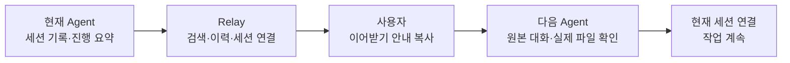

# Relay

> **도구를 한곳에, 업무를 하나의 흐름으로.**

Relay는 **AI Agent 세션, 메모, 파일 탐색기, 뷰어, 계산기 등 업무에 필요한 도구를 한 화면에 모으는 Windows용 로컬 업무 플랫폼**입니다.

세션 사이에 작업 맥락을 이어 주는 도구에서 출발해, 기록을 찾고 생각을 정리하고 자료를 확인하는 일까지 담는 앱으로 확장하고 있습니다. 여러 도구를 데스크톱 형태의 작업 공간에서 함께 열고, 필요한 순간에 오가며 사용할 수 있습니다.

평소에는 업무 도구를 열어 쓰고, AI와 작업할 때는 세션 기록과 인계 기능을 함께 활용하세요. 세션을 등록하지 않아도 메모·파일 탐색기·계산기를 사용할 수 있습니다.

## 목차

- [Relay에 모인 도구](#relay에-모인-도구)
- [시작하기](#시작하기)
- [한 화면에서 일하기](#한-화면에서-일하기)
- [AI와 작업 이어가기](#ai와-작업-이어가기)
- [Agent 연동](#agent-연동)
- [명령](#명령)
- [데이터와 설정](#데이터와-설정)
- [업데이트와 제거](#업데이트와-제거)
- [문제 해결](#문제-해결)
- [개발과 API](#개발과-api)

## Relay에 모인 도구

| 도구 | 할 수 있는 일 |
| --- | --- |
| **세션** | Claude Code·Codex·Grok·Cursor의 작업 기록을 검색하고, 진행 요약·이력·연결 관계를 확인하고 다음 Agent에게 전달합니다. |
| **메모** | 생각과 할 일을 Markdown으로 쓰고, 폴더와 하위 폴더로 정리하고, 검색·내보내기·가져오기를 합니다. |
| **파일 탐색기** | PC의 드라이브와 폴더를 둘러보고, 즐겨찾기·검색·미리 보기·복사·이동·삭제·속성 확인을 합니다. |
| **뷰어** | 그림을 확대·회전하며 보고, Markdown과 텍스트·소스 코드 파일을 읽습니다. 소스 코드는 줄 번호와 구문 강조로 표시합니다. |
| **계산기** | 사칙연산·괄호·퍼센트 계산을 하고, 저장된 식과 결과를 다시 꺼내 씁니다. |
| **YouTube** | 영상·재생목록을 창 안에서 재생합니다. 검색과 창 안에서 재생할 수 없는 영상은 YouTube에서 엽니다. |
| **가이드** | Relay의 사용 방법과 세션을 기록하고 이어받는 절차를 확인합니다. |
| **명령** | 선택한 세션의 조회 명령·이어받기 안내·원본 대화 재개 명령을 PowerShell 또는 Bash 형식으로 복사합니다. |
| **설정** | 테마·글자 크기·바탕화면·창 배치를 조정하고, 앱 설치와 저장소 정보를 확인합니다. |

Relay는 이 도구들이 함께 쓰는 **작업 공간**을 제공합니다.

- **익숙한 창 조작**: 메뉴바와 Dock에서 도구를 열고, 창을 나란히 배치하거나 최소화·최대화합니다.
- **내 PC에 남는 기록**: 세션·메모·계산 이력은 로컬 SQLite 저장소에 보관합니다.
- **하나의 실행 파일**: 런타임과 웹 화면을 `relay.exe`에 담아, 설치 후 별도 개발 환경 없이 실행합니다.
- **앱과 CLI를 함께**: 일상 도구는 화면에서 쓰고, Agent의 세션 기록과 자동화는 CLI로 처리합니다.

## 시작하기

### 설치

Windows 10/11 x64를 지원합니다. 소스에서 빌드하려면 **Node.js 22.12 이상과 npm**이 필요하며, Bun은 npm 의존성으로 설치됩니다.

```powershell
npm ci
npm run build
.\scripts\install-cli.ps1
```

설치 스크립트는 `%USERPROFILE%\.local\bin\relay.exe`를 설치하고 사용자 PATH, `relay://` 링크, Agent 훅과 `relay-session` 스킬을 구성합니다. 이미 빌드된 실행 파일이 있으면 설치 스크립트만 실행하면 됩니다. 설치 후 일반 실행에는 Node.js·Bun·관리자 권한이 필요 없습니다.

```powershell
relay --version
relay web --headless --open
```

기본 브라우저에 **`http://127.0.0.1:7474`**가 열립니다. 하단 Dock에서 필요한 도구를 선택하세요. 백그라운드 서버는 터미널을 닫아도 유지됩니다. `relay`를 찾지 못하면 새 터미널을 여세요.

### 앱으로 설치

Chrome·Edge에서 주소 표시줄의 앱 설치 아이콘이나 Relay의 **설정 → 앱 → 앱으로 설치**를 누르면, 브라우저 탭 없이 별도 창으로 실행할 수 있습니다. 설치 단추가 보이지 않으면 브라우저 메뉴의 앱 설치를 사용하세요.

- 작업 표시줄·시작 메뉴에서 Relay를 바로 엽니다.
- 창 오른쪽 위 `⌃` 단추로 제목 표시줄을 숨기고, 메뉴바의 빈 곳을 끌어 창을 옮깁니다.
- 서버가 꺼져 있으면 Windows의 `relay://` 링크로 백그라운드 서버를 켭니다. 처음 뜨는 브라우저 확인 창에서 허용하고 `항상 허용`을 선택하면 이후 실행이 편해집니다.
- 자동으로 연결되지 않으면 화면의 `서버 켜기`를 누르거나 `relay web --headless`를 실행하세요. 서버가 뜨면 화면이 다시 연결됩니다.

앱은 설치한 주소와 포트에 연결됩니다. 평소 같은 포트를 사용하세요. YouTube 재생에는 인터넷 연결이 필요합니다.

## 한 화면에서 일하기

Dock에서 메모와 파일 탐색기, 계산기 등을 함께 열어 두고 창 사이를 오가며 작업합니다. 창 위치·크기와 패널 폭을 기억하며, 좁은 화면에서는 창이 전체 화면으로 바뀝니다. 테마·글자 크기·바탕화면은 설정에서 바꿀 수 있습니다.

### 메모로 정리하기

메모와 폴더를 만들고, 끌어 놓기나 메뉴로 위치를 정리합니다. 제목·본문·폴더 이름을 검색하고, 체크리스트·표·링크·코드 블록을 넣어 할 일과 참고 내용을 남기세요.

- **서식 / Markdown 전환**: 서식 도구와 Markdown 입력을 함께 지원하며 원문을 직접 고칠 수 있습니다.
- **자동 저장**: 메모는 Relay DB에 저장됩니다. 서버 연결이 끊긴 동안의 변경은 브라우저에 보관했다가 다시 연결되면 전송합니다.
- **파일로 보관**: 개별 메모는 `.md`로 내려받고, 전체 메모·폴더는 JSON으로 내보내 다른 PC나 저장소에 가져옵니다.

```powershell
relay notes export "C:\backup\relay-notes.json"
relay notes import "C:\backup\relay-notes.json"
```

가져오기는 기존 메모에 합치는 방식입니다. 없는 항목은 추가하고, 같은 ID는 더 최근에 수정한 쪽을 남기며, 기존 항목을 삭제하지 않습니다.

### 파일을 찾고 내용 확인하기

파일 탐색기의 `이 PC`에서 드라이브와 즐겨찾기를 열고, 폴더 트리·위치 경로·뒤로/앞으로 이동으로 자료를 찾습니다. 이름 필터, 목록·아이콘 보기, 정렬, 숨김 항목 표시를 지원합니다.

- **미리 보기**: 그림·영상·소리·텍스트와 PDF 첫 페이지를 선택한 항목 옆에서 확인합니다.
- **파일 정리**: 복사·잘라내기·붙여넣기와 삭제를 지원합니다. Windows의 `복사`·`Ctrl+C`는 시스템 파일 클립보드에도 복사하므로 Windows 탐색기나 파일 붙여넣기를 지원하는 앱에서 `Ctrl+V`로 붙여넣을 수 있습니다. Windows에서 삭제한 항목은 휴지통으로 보냅니다.
- **새 폴더·이름 바꾸기**: 빈 곳을 오른쪽 클릭해 `새 폴더`를 만들면 바로 이름을 입력할 수 있습니다. 목록의 파일·폴더나 왼쪽 트리의 폴더를 오른쪽 클릭하고 `이름 바꾸기`를 고르거나, 항목에 초점을 두고 `F2`를 누르면 그 자리에서 이름을 고칩니다. Enter로 확정하고 Esc로 취소합니다.
- **여러 항목 고르기**: `Ctrl`+클릭으로 하나씩, `Shift`+클릭으로 범위를 고르고 `Ctrl+A`로 모두 고릅니다. 여럿을 고르면 체크 모드가 되어 맨 왼쪽에 체크 상자 열이 열리고, 이때는 그냥 눌러도 그 항목만 체크하거나 풉니다. 체크가 모두 풀리거나 빈 곳을 누르면 체크 모드가 끝납니다. 고른 항목은 한꺼번에 복사·잘라내기·삭제합니다.
- **뷰어로 열기**: 그림·텍스트·Markdown·소스 코드 파일을 두 번 누르면 Relay 뷰어에 열립니다. 같은 폴더의 같은 종류 파일은 이전·다음으로 넘깁니다.
- **보기 도구**: 그림은 확대·축소·회전·창에 맞춤을, 글은 줄 바꿈·글자 크기 조절을 지원합니다. Markdown은 서식과 원문을 전환하며, 소스 코드는 구문 강조로 읽습니다.
- **다른 앱으로 이어가기**: 기본 앱으로 열기, Windows 탐색기에서 보기, 내려받기, 경로 복사를 사용합니다.

실행 파일은 직접 실행하는 대신 탐색기에서 선택해 보여 줍니다. 네트워크 UNC 경로는 지원하지 않으며, 한 폴더는 이름 순으로 최대 5,000개 항목을 표시합니다.

### 계산하고 결과 다시 쓰기

키패드나 키보드로 식을 입력합니다. 곱셈·나눗셈의 우선순위와 괄호·퍼센트를 지원하고, `=`로 끝낸 계산은 식과 결과를 함께 저장합니다.

최근 500개 이력을 날짜별로 확인하고, 결과를 눌러 다음 계산에 쓰거나 메뉴에서 식 다시 쓰기·복사·삭제를 합니다. 계산 이력은 Relay DB에 있어 같은 저장소를 쓰는 다른 브라우저에서도 확인할 수 있습니다.

### 영상을 곁에 두기

YouTube 창의 주소창에 영상·재생목록 주소나 영상 ID를 입력합니다. 시작 시각이 있는 주소도 그대로 사용할 수 있고, 뒤로·앞으로 이동과 최근 본 항목을 지원합니다. 최소화하면 재생을 유지하며, 창을 닫으면 보던 영상과 최근 본 항목을 지웁니다. 검색과 재생이 제한된 영상은 외부 YouTube 페이지에서 엽니다.

## AI와 작업 이어가기

세션 연결은 Relay가 제공하는 업무 도구 중 하나이자, 처음 출발한 기능입니다. Codex로 하던 일을 Claude Code·Grok·Cursor 또는 새 대화에서 이어갈 때, 어느 프로젝트에서 무엇을 했고 다음에 무엇을 할지 찾을 단서를 남깁니다.



### 기록하고 갱신하기

설치된 시작·종료 훅이 세션 식별 정보와 종료 시각을 기록하고, Agent가 작업 단위마다 목표·변경 파일·검증 결과·남은 일을 요약합니다. 모델과 컨텍스트 압축 기록은 훅이 채우고, CLI 기록에는 Git 브랜치·커밋·수정 파일 수가 단서로 붙습니다.

Codex의 PowerShell 예시입니다. 실제 세션 ID를 환경변수 그대로 사용합니다.

```powershell
relay show $env:CODEX_THREAD_ID --provider openai --json
```

기록이 없을 때만 첫 기록을 만듭니다. 훅이 이미 기록했으면 아래 `record`를 건너뛰고 `update`로 갱신합니다.

```powershell
relay record --provider openai --agent codex --session-id $env:CODEX_THREAD_ID --session-name "로그인 수정" --summary "로그인 콜백 확인 중"
relay update --session-id $env:CODEX_THREAD_ID --session-name "로그인 수정" --status handoff --summary "콜백 수정, 테스트 통과. 모바일 확인 필요"
```

`--status`는 `working`(작업 중)·`blocked`(막힘)·`handoff`(인계 대기)·`done`(완료) 중 마지막 작업 상태입니다. 프로세스 실행 여부와는 별개입니다. **훅 자동 기록만 있고 `update`가 없는 세션은 종료 시 정리되므로**, 남길 작업은 첫 작업 단위가 끝나면 반드시 갱신합니다. `pin`으로 고정하면 종료 정리와 보관 기간 자동 삭제에서 제외됩니다.

### 찾아서 전달하기

세션 창에서 이름·요약·경로를 검색하고, 제공자·도구·프로젝트·작업 상태·고정 여부로 필터합니다. 상세의 **개요 / 기록 이력 / 세션 연결**에서 진행 상황과 이전·다음 세션을 확인합니다. 상태 변경·종료 처리·고정·삭제는 목록의 오른쪽 클릭 메뉴에서도 할 수 있습니다.

| 복사할 내용 | 사용할 때 |
| --- | --- |
| **세션 컨텍스트** | 다음 Agent에게 작업을 이어받도록 요청할 때. Relay 조회 명령과 원본 대화·실제 파일 확인 절차가 담깁니다. |
| **조회 명령 / Agent Session ID** | 특정 세션을 직접 조회하거나 원본 기록을 찾을 때 |
| **인계 문서** | `relay`가 없는 웹 챗이나 다른 PC에 요약·이력·연결 관계를 Markdown으로 전달할 때 |
| **원본 세션 재개 명령** | `codex resume`, `claude --resume` 등으로 원래 도구의 대화를 다시 열 때 |

터미널에서도 목록을 선택해 상세를 보고 이어받기 안내를 복사할 수 있습니다.

```powershell
relay list
relay --codex
relay latest claude --json
relay handoff '<Agent Session ID>' --provider openai
```

### 다음 세션에서 이어받기

작업을 이어가라는 요청을 받은 Agent는 원본 대화에서 요구사항을 확인하고, 프로젝트 지침·실제 파일·작업 트리로 현재 상태를 확인합니다. `continue`는 이전 세션과 현재 세션을 부모·자식으로 연결합니다. 이어받을 때는 별도로 `record`하지 않고 `continue`를 사용합니다.

```powershell
relay continue '<이전 Agent Session ID>' --parent-provider xai --provider openai --agent codex --session-id $env:CODEX_THREAD_ID --summary "이전 로그인 수정 확인. 모바일 동작 검증 진행"
```

단순 조회는 작업 재개나 세션 연결을 실행하지 않습니다. Relay 요약은 원본 대화를 찾는 단서이며 전체 대화나 요구사항을 대신하지 않습니다. 원본 로그를 수집하거나 실행 중인 Agent를 전환하지 않으며, `continue`도 원본 대화를 자동 재개하지 않습니다.

<details>
<summary>세션 용어와 터미널 조작</summary>

### 세션 용어

| 용어 | 설명 |
| --- | --- |
| **Agent Session ID** | Claude Code, Codex, Grok이 각자 발급하는 36자 UUID입니다. Relay는 이 값을 그대로 저장하고 CLI 조회에 씁니다. JSON 필드는 `providerSessionId`입니다. |
| **Relay 내부 ID** | `ses_`로 시작하는 Relay 저장소 식별자입니다. 웹 API와 부모·자식 연결에만 쓰며, CLI 조회에 넣으면 올바른 `relay show` 명령을 안내합니다. JSON 필드는 `id`입니다. |
| **provider / agent** | 회사 식별자와 도구 식별자입니다. `openai`/`codex`, `anthropic`/`claude-code`, `xai`/`grok`, `cursor`/`cursor-agent`. |
| **출처 별칭** | `codex`, `claude`, `grok`, `cursor`. 조회할 **이전 작업의 출처**를 한 단어로 가리키며, 현재 Agent를 바꾸는 옵션이 아닙니다. |
| **훅 자동 기록** | 시작 훅이 만든 첫 기록입니다. 세션 이름은 작업 폴더명, 요약은 `세션 첫 기록 (훅 자동 기록)`이며 실제 단서는 Agent가 `update`로 채웁니다. |
| **세션 연결** | `continue`가 남기는 부모·자식 관계입니다. 이전 세션이 부모, 이어받은 세션이 자식입니다. |
| **종료 기록** | 종료 훅이 남기는 `endedAt`과 `endReason`입니다. 없으면 `진행 중`으로 표시되지만, 강제 종료된 세션도 훅이 돌지 않아 `진행 중`으로 남을 수 있습니다. 브라우저는 종료 기록 없이 6시간 넘게 갱신이 없으면 `응답 없음`으로 표시합니다. |
| **작업 상태** | Agent가 `--status`로 마지막에 선언한 상태입니다. `working`(작업 중) · `blocked`(막힘) · `handoff`(인계 대기) · `done`(완료). 프로세스의 실행 여부가 아니며 다음 `--status`까지 유지됩니다. JSON 필드는 `status`입니다. |
| **고정** | `relay pin`으로 표시한 세션입니다. 보관 기간 자동 삭제와 훅 종료 정리에서 제외되며 JSON 필드는 `pinned`입니다. |
| **Git 단서** | CLI로 기록한 시점의 브랜치·짧은 커밋 해시·수정 파일 수입니다. JSON 필드는 `git`이며 저장소 밖이면 `null`입니다. |
| **압축 기록** | PreCompact 훅이 남기는 컨텍스트 압축 횟수·마지막 시각·계기입니다. JSON 필드는 `compaction`이며, 있으면 압축 전 대화의 세부가 기록에 없을 수 있다는 뜻입니다. |
| **모델** | 세션이 쓴 모델을 처음 쓴 순서대로 쉼표로 이은 목록입니다(예: `claude-opus-5-5, claude-fable-5-1`). 훅이 채우며 JSON 필드는 `model`입니다. Claude Code는 시작할 때 모델을 알려 주지 않으므로, 모델을 바꾸거나 압축·종료하기 전까지는 `미기록`으로 보일 수 있습니다. |

### 터미널

`relay list`와 단축 조회는 아래 열을 표시합니다. 이름과 Agent Session ID는 항상 남고, 터미널이 좁으면 요약, 생성, 갱신, 상태, Agent, 프로젝트 순으로 숨깁니다.

| 열 | 내용 |
| --- | --- |
| 이름 | 세션 이름. 훅이 기록한 세션은 프로젝트 폴더명 |
| 프로젝트 | 작업 경로의 폴더명 |
| Agent | 도구 이름. 제공자별로 색이 다름 |
| 상태 | Agent가 선언한 작업 상태와 `고정` 표시. 둘 다 없으면 비어 있음 |
| Agent Session ID | 원본 도구의 실제 세션 ID |
| 생성 · 갱신 | 로컬 시각을 `26.09.17 18:00` 형식으로 표시 |
| 요약 | 마지막 진행 요약 |

터미널에서 직접 실행하면 행을 골라 상세를 보고 복사하는 선택 화면이 열립니다. 상세는 브라우저 상세와 같은 내용(최근 작업 요약, 세션 정보, 기록 이력, 세션 흐름, 세션 연결)을 한 화면에 담습니다. 세션 정보에는 작업 상태·고정, Git 단서, 원본 세션 재개 명령이 함께 보입니다. 파일로 리디렉션하거나 Agent가 비대화형으로 호출하면 선택 화면 없이 표 또는 JSON만 출력합니다.

| 조작 | 동작 |
| --- | --- |
| 마우스 이동 · `↑` `↓` · `j` `k` · `PgUp` `PgDn` · `g` `G` | 목록에서 행 이동, 상세에서 스크롤 |
| 클릭 · `Enter` · `Space` | 목록에서 선택한 세션의 상세 열기, 상세에서 이어받기 안내를 복사하고 닫기 |
| `Backspace` · 상세에서 `Esc` | 상세에서 목록으로 돌아가기 |
| `q` · `Ctrl+C` · 목록에서 `Esc` | 복사하지 않고 닫기 |

선택 화면은 `RELAY_NO_TUI=1`, 색상은 `NO_COLOR=1`로 끕니다. Windows 클립보드에서 한글이 깨지면 `RELAY_CLIPBOARD=powershell`을 지정하세요.

</details>

## Agent 연동

CLI 설치 또는 `relay install-hooks`로 스킬·세션 훅·시작 안내를 함께 구성합니다. Claude Code·Codex는 시작 훅으로, Grok은 자동 로드되는 사용자 규칙으로 안내를 받으므로 프로젝트마다 같은 프롬프트를 넣을 필요가 없습니다. 프로젝트별 추가 지침은 `AGENTS.md`에 둡니다.

### 스킬 설치

[skills/relay-session](skills/relay-session/SKILL.md)은 Agent가 Relay를 기록·조회·이어받는 절차를 담은 스킬입니다. `relay install-skills`가 이 스킬을 세 도구의 사용자 스킬 폴더에 실제 사본으로 설치하므로 모든 프로젝트에서 바로 쓸 수 있습니다. `install-cli.ps1`이 설치 끝에 한 번 실행하며, 스킬이 바뀐 뒤에는 직접 실행합니다.

```powershell
relay install-skills
relay install-skills --force
```

| 도구 | 설치 위치 | 비고 |
| --- | --- | --- |
| Claude Code | `~/.claude/skills/relay-session` | `argument-hint` 포함 |
| Grok | `$GROK_HOME/skills/relay-session` (기본 `~/.grok/skills/relay-session`) | `argument-hint` 포함 |
| Codex | `~/.codex/skills/relay-session` (`CODEX_HOME`이 설정돼 있으면 그 폴더에도) | `agents/openai.yaml` 포함 |
| Cursor | 별도 사본 없음 | Cursor가 `~/.claude/skills`와 `~/.codex/skills`를 함께 읽으므로 위 사본을 그대로 씁니다 |

스킬 폴더는 심볼릭 링크나 정션으로 연결하지 않습니다. 링크는 가리키던 폴더가 옮겨지거나 지워지면 끊어지고, 그러면 Agent가 "심볼릭 링크 문제로 스킬을 못 쓴다"고 보고합니다. `install-skills`는 설치 위치에 링크가 있으면 링크 항목만 지우고 실제 사본으로 바꾸며, 링크가 가리키던 폴더는 건드리지 않습니다. 기존 사본의 내용이 다르면 덮어쓰지 않고 `건너뜀`으로 알리므로 확인한 뒤 `--force`로 교체합니다. Claude Code는 `~/.agents/skills`를 읽지 않으므로 그 폴더에 복사하거나 연결하는 방식은 쓰지 않습니다.

특정 프로젝트에만 두려면 설치 스크립트를 사용합니다. 기존 파일 내용이 다르면 덮어쓰지 않고 중단하며, 설치 위치가 링크이면 실제 사본으로 바꿉니다.

```powershell
.\scripts\install-skill.ps1 -Agent codex -ProjectDirectory "C:\workspace\my-project"
.\scripts\install-skill.ps1 -Agent claude -ProjectDirectory "C:\workspace\my-project"
.\scripts\install-skill.ps1 -Agent grok -ProjectDirectory "C:\workspace\my-project"
```

각각 `.agents/skills/relay-session`, `.claude/skills/relay-session`, `.grok/skills/relay-session`에 배치됩니다. 프로젝트 사본은 사용자 스킬보다 우선하므로 스킬을 갱신하면 프로젝트 사본도 다시 설치합니다. 스킬을 인식한 Codex에서는 `$relay-session grok`, Claude Code와 Grok에서는 `/relay-session grok`으로 Grok 기록을 조회할 수 있습니다.

### 프로젝트 지침

프로젝트의 `AGENTS.md` 또는 `CLAUDE.md`에 아래 지침을 추가하면 Agent가 첫 작업 전에 기록 절차를 수행합니다. 이 저장소의 [AGENTS.md](AGENTS.md)가 실제 예시입니다.

```text
세션의 첫 작업 전에 relay-session 스킬을 읽고, 그 절차에 따라 현재 세션 정보를 Relay에 기록한다.
명령을 추측하지 않는다. 스킬을 찾지 못하거나 링크 문제로 읽히지 않으면 relay --help로 확인하고, relay install-skills로 다시 설치하라고 한 줄로 알린다.
호스트가 제공한 실제 세션 ID만 사용하고, 기존 기록을 먼저 확인해 없을 때만 생성한다.
이전 작업을 이어받으면 continue로 출처를 연결하고, 작업 단위가 끝나면 짧은 진행 단서를 갱신한다.
중간 작업 내용 또한 Relay 도구로 기록해 목표·현재 상태·변경 파일·검증 결과·남은 위험이나 다음 작업을 짧게 남긴다.
update를 한 번도 남기지 않은 세션 기록은 종료 시 삭제되므로 첫 작업 단위가 끝나면 반드시 갱신한다.
relay가 없거나 기록에 실패하면 한 줄로 알리고 원래 작업을 계속한다.
```

세션 ID는 각 도구가 환경변수로 제공합니다. Agent는 이 값을 그대로 쓰고 임의로 만들지 않습니다.

| 도구 | 환경변수 | `--provider` / `--agent` |
| --- | --- | --- |
| Claude Code | `CLAUDE_CODE_SESSION_ID` | `anthropic` / `claude-code` |
| Codex | `CODEX_THREAD_ID` | `openai` / `codex` |
| Grok | `GROK_SESSION_ID` | `xai` / `grok` |
| Cursor | 없음. `sessionStart` 훅이 맥락에 넣어 주는 `sessionId`(`conversation_id`) 사용 | `cursor` / `cursor-agent` |

### 시작·종료 훅

`relay install-hooks`가 네 도구의 SessionStart·SessionEnd·PreCompact 훅과 Claude Code의 PostModelSwitch 훅, 시작 안내와 `relay-session` 스킬을 함께 설치합니다. `install-cli.ps1`도 이 명령을 호출하므로 CLI 설치 때 자동으로 적용됩니다. `relay.exe`를 실행할 때마다 빠진 훅과 Grok 시작 안내를 다시 채웁니다. 기존의 다른 훅은 유지하고, Relay 항목이 이미 있으면 실행 파일 경로와 제한 시간만 맞춥니다.

| 도구 | 훅 위치 | 시작 명령 | 종료 명령 | 압축 명령 |
| --- | --- | --- | --- | --- |
| Claude Code | 사용자 설정 `hooks.SessionStart` · `SessionEnd` · `PreCompact` · `PostModelSwitch` | `relay.exe hook claude` | `relay.exe hook claude --end` | `relay.exe hook claude --compact` (모델 전환: `relay.exe hook claude --model-switch`) |
| Codex | `~/.codex/hooks.json` (`CODEX_HOME`이 설정돼 있으면 그 폴더에도) | `relay-hook-codex.cmd` | `relay-hook-codex-end.cmd` | `relay-hook-codex-compact.cmd` |
| Grok | `$GROK_HOME/hooks/relay.json` (기본 `~/.grok/hooks/relay.json`) | `relay-hook-grok.cmd` | `relay-hook-grok-end.cmd` | `relay-hook-grok-compact.cmd` |
| Cursor | `~/.cursor/hooks.json`의 `sessionStart` · `sessionEnd` · `preCompact` | `relay-hook-cursor.cmd` | `relay-hook-cursor-end.cmd` | `relay-hook-cursor-compact.cmd` |

Claude Code 설정 예시입니다. Codex와 Grok은 같은 구조에 래퍼 `.cmd` 경로를 넣습니다.

```json
{
  "hooks": {
    "SessionStart": [
      { "hooks": [{ "type": "command", "command": "\"C:/Users/<사용자>/.local/bin/relay.exe\" hook claude || echo {}", "timeout": 10 }] }
    ],
    "SessionEnd": [
      { "hooks": [{ "type": "command", "command": "\"C:/Users/<사용자>/.local/bin/relay.exe\" hook claude --end || echo {}", "timeout": 10 }] }
    ]
  }
}
```

- Codex·Claude Code의 시작 훅은 `hookSpecificOutput.additionalContext`로 위 프로젝트 지침에 해당하는 안내를 Agent에게 전달합니다. 스킬 읽기, `relay --help` 확인, 기존 기록 조회, `continue` 연결, 중간 진행 요약과 실패 시 작업 계속을 안내하며, 호스트가 제공한 실제 세션 ID와 provider/agent도 함께 전달합니다. 시작·재개 시 Agent의 맥락에 추가되는 안내이며 채팅창에 사용자 메시지로 입력되지는 않습니다.
- Grok은 SessionStart 출력을 무시하므로 같은 안내를 `$GROK_HOME/rules/relay-session.md`(기본 `~/.grok/rules/relay-session.md`)에 설치합니다. Grok이 세션 시작 때 자동으로 읽는 [사용자 전역 규칙](https://github.com/xai-org/grok-build/blob/main/crates/codegen/xai-grok-pager/docs/user-guide/12-project-rules.md#rules-directories)이며 실제 ID는 현재 호스트의 `GROK_SESSION_ID`를 사용합니다. 설치 결과에 안내 파일 경로와 상태가 표시됩니다. 반복 등록해도 중복되지 않고, Relay가 관리하는 사본만 갱신합니다. 같은 경로의 사용자 파일이나 링크는 덮어쓰지 않고 `건너뜀`으로 알립니다. 응답 형식과 제한은 [Codex 훅 문서](https://learn.chatgpt.com/docs/hooks#sessionstart), [Claude Code 훅 문서](https://code.claude.com/docs/en/hooks#sessionstart), [Grok 훅 문서](https://github.com/xai-org/grok-build/blob/main/crates/codegen/xai-grok-pager/docs/user-guide/10-hooks.md#output-passive-hooks)를 기준으로 합니다.
- Cursor의 `sessionStart` 훅은 같은 안내를 Cursor가 읽는 `additional_context`로 돌려주고, 세션 ID는 페이로드의 `conversation_id`(Cursor CLI가 `agent --resume`에 쓰는 chat id)를 씁니다. 작업 경로는 `workspace_roots`의 첫 항목입니다. 설정 형식은 [Cursor 훅 문서](https://cursor.com/docs/agent/hooks)를 따릅니다.
- 모든 훅은 세션의 모델 목록(`model`)도 채웁니다. 페이로드의 `model`(Codex·Cursor는 모든 이벤트에 있음)과 Claude Code `PostModelSwitch`의 `to_model`, 그리고 `transcript_path` 대화 기록에서 실제로 응답한 모델(Claude Code는 본 대화 응답의 `message.model`, Codex는 `turn_context`의 `model`)을 처음 쓴 순서대로 더합니다. 서브에이전트 응답과 Claude Code가 스스로 만든 `<synthetic>` 응답은 빼며, 요약·갱신 시각·이력은 건드리지 않습니다. 모델 전환 훅은 `{}`를 돌려주므로 Agent 맥락에 아무것도 더하지 않습니다.
- 호스트가 컨텍스트를 압축하면 `PreCompact` 훅이 세션의 `compaction`(횟수·마지막 시각·계기)만 갱신하고 `{}`를 돌려줍니다. Claude Code와 Codex는 압축 뒤 `source: compact`로 시작 훅을 다시 부르는데, 이때는 첫 기록 안내 대신 `relay show --history`로 기록을 다시 읽고 `update`로 보완하라는 안내를 넣습니다. Grok은 같은 안내를 시작 규칙 파일에서 읽습니다.
- 훅은 저장소를 열기 전에 JSON 응답 한 건을 출력하고 기록을 시도합니다. 종료 훅·압축 훅·Grok 시작 훅·사용할 수 없는 입력은 `{}`를 반환하며, 기록 오류가 도구의 세션을 막지 않습니다.
- 세션 ID는 페이로드의 `session_id`, `sessionId`, `thread_id`, 그다음 해당 도구의 환경변수 순으로 찾습니다. 다른 도구의 환경변수는 사용하지 않으며, 서브에이전트 페이로드(`agent_id`, `subagentType`, `subagent_type`)는 기록하거나 안내하지 않습니다.
- 시작 훅은 작업 폴더 이름과 `세션 첫 기록 (훅 자동 기록)` 요약으로 등록합니다. 같은 세션이 다시 시작돼도 이력이 늘지 않습니다.
- 종료 훅은 종료 시각(`endedAt`)과 도구가 보낸 사유(`endReason`, 예: `prompt_input_exit`, `logout`)를 남깁니다. 마지막 갱신 시각과 요약 이력은 바뀌지 않습니다.
- 이력이 훅 자동 기록 한 건뿐이고 이어받은 세션도 없으면 종료 시 기록을 삭제합니다. 같은 세션이 다시 시작되거나 `update`·`continue`가 오면 종료 기록을 지웁니다.
- 훅의 제한 시간은 10초이지만, Codex는 SessionEnd 훅에 최대 3초만 허용하므로 Codex 종료 훅은 3초로 등록합니다.
- Codex는 등록된 시작·종료 항목을 `/hooks`에서 각각 신뢰해야 실행됩니다. Orca처럼 `CODEX_HOME`을 따로 두는 호스트에서 실행한 Codex는 그 폴더의 `hooks.json`을 읽으므로, 그 환경변수가 있는 셸에서 `relay install-hooks`를 한 번 실행하세요.
- 훅을 등록하고 싶지 않으면 `RELAY_SKIP_HOOK_INSTALL=1`을 설정한 뒤 각 도구 설정에서 Relay 항목을 지웁니다. Grok 시작 안내도 끄려면 `rules/relay-session.md`를 함께 지웁니다.

훅은 첫 기록을 자동화하는 편의 장치이지 기록의 전제 조건이 아닙니다. 훅이 없거나 실행되지 않았어도 Agent는 스킬 절차대로 `record`하고 `continue`합니다.

## 명령

| 명령 | 용도 |
| --- | --- |
| `relay --codex` / `--claude` / `--grok` / `--cursor` | 해당 출처의 최근 세션 한 건을 상세로 열고 조회 명령 복사 |
| `relay latest <별칭> [--cwd <경로>]` | 출처의 최근 갱신 기록 한 건 |
| `relay list [--query <텍스트>] [--provider] [--agent] [--cwd] [--status] [--pinned]` | 세션 목록과 부분 검색, 작업 상태·고정 필터 |
| `relay show <Agent Session ID> [--provider] [--history]` | 세션 상세와 요약 이력 |
| `relay chain <Agent Session ID> [--provider]` | 처음 세션부터 이어받은 세션까지 작업 흐름 전체 |
| `relay handoff <Agent Session ID> [--provider] [--limit] [--shell]` | 요약·이력·흐름·명령을 담은 인계 문서(Markdown) 출력. `--json`이면 `markdown` 필드 |
| `relay record --provider --agent --session-id --summary [--session-name] [--model] [--status] [--cwd]` | 현재 세션 첫 기록 |
| `relay update --session-id <ID> --summary <요약> [--provider] [--session-name] [--status]` | 진행 요약 갱신. 이름과 작업 상태는 준 것만 바뀜 |
| `relay continue <이전 ID> --parent-provider <제공자> ...` | 이전 세션에 현재 세션 연결. 나머지 옵션은 `record`와 같음 |
| `relay pin <ID>` / `relay unpin <ID>` | 보관 기간 자동 삭제와 종료 정리에서 제외, 또는 해제 |
| `relay delete <ID> [--provider] [--force]` | 기록과 이력 삭제. 이어받은 세션이 있으면 `--force`로 연결을 끊고 삭제 |
| `relay notes export <파일>` / `relay notes import <파일>` | 모든 메모·폴더를 JSON 파일로 내보내기, 내보낸 파일을 합치기(없는 항목은 넣고 같은 항목은 더 최근 쪽을 남김, 지우지 않음). 다른 PC·저장소로 메모를 옮길 때 |
| `relay install-hooks [--bin-dir <경로>]` | SessionStart·SessionEnd 훅·시작 안내 등록 및 스킬 설치 |
| `relay install-skills [--force]` | `relay-session` 스킬을 세 도구의 사용자 스킬 폴더에 실제 사본으로 설치. 링크는 사본으로 교체 |
| `relay web [--open] [--port <번호>] [--headless] [--close] [--reload] [--free-port]` | 업무 화면의 로컬 서버 실행, 백그라운드 실행, 종료, 다시 시작, 예약된 포트 풀기 |
| `relay open-url <relay://web?port=번호>` | 브라우저가 연 `relay://` 링크 처리(설치 스크립트가 Windows에 등록). 그 포트에 백그라운드 서버를 켬 |

전역 옵션은 `--data-dir <절대경로>`와 `--json`입니다. Agent나 스크립트에서는 `--json`을 붙이세요. 성공 결과는 stdout, 실패는 stderr에 JSON 하나로 출력됩니다. 종료 코드는 `0` 성공, `2` 입력·설정 오류, `3` 기록 없음(`SESSION_NOT_FOUND`), `4` 충돌(`PARENT_CONFLICT`, `SESSION_EXISTS`, `AMBIGUOUS_SESSION_ID`, `SESSION_LINKED`), `5` 저장소 오류, `6` 서버 시작·종료 실패입니다.

### 조회 별칭

| 별칭 | provider | agent |
| --- | --- | --- |
| `codex` | `openai` | `codex` |
| `claude` | `anthropic` | `claude-code` |
| `grok` | `xai` | `grok` |
| `cursor` | `cursor` | `cursor-agent` |

"최근"의 기준은 Relay의 마지막 갱신 시각 `updatedAt`입니다. `latest`와 단축 조회는 기본적으로 모든 프로젝트를 대상으로 하며, `--cwd`를 주면 정확히 일치하는 경로의 기록만 찾습니다. 범위에 기록이 없으면 `SESSION_NOT_FOUND`를 반환하고 다른 프로젝트나 제공자로 자동 전환하지 않습니다. 같은 Agent Session ID가 여러 제공자에 있으면 `--provider`를 지정합니다.

### 조회 결과 필드

`--json` 응답은 `schemaVersion: 1`과 camelCase 필드를 씁니다. `latest`와 `show`에서 Agent가 보는 단서입니다.

| 필드 | 의미 |
| --- | --- |
| `session.provider` / `session.agent` | 어떤 제공자와 도구의 세션인지 |
| `session.providerSessionId` | 원본 세션을 찾을 때 쓰는 실제 Agent Session ID |
| `session.workingDirectory` | 어느 프로젝트에서 한 작업인지 |
| `session.sessionName` / `session.summary` | 어떤 작업을 하던 세션인지, 마지막 요약 |
| `session.createdAt` / `session.updatedAt` | Relay에 처음 기록하고 마지막으로 갱신한 시각 |
| `session.endedAt` / `session.endReason` | 종료 훅이 남긴 종료 시각과 사유. 없으면 `null` |
| `session.status` / `session.pinned` | Agent가 마지막으로 선언한 작업 상태(`working`·`blocked`·`handoff`·`done`, 없으면 `null`)와 고정 여부. 이력의 `updates[].status`는 각 기록 시점의 상태 |
| `session.git` | 기록 시점의 `branch`·`commit`·`dirty`(수정 파일 수)·`at`. 저장소 밖이거나 훅 자동 기록이면 `null` |
| `session.compaction` | PreCompact 훅이 남긴 `count`·`lastAt`·`trigger`(`auto`/`manual`). 압축이 없었으면 `null` |
| `session.model` | 훅이 모은 모델 목록(처음 쓴 순서, `, `로 구분). 아직 모르면 `null` |
| `parentSession` / `children` / `childrenPage` | 이어받은 이전 세션과 이 세션을 이어받은 세션들 |

## 데이터와 설정

저장소 폴더는 `--data-dir` → `RELAY_DATA_DIR` 환경변수 → 사용자 홈의 `.relay` 순으로 정합니다. 그 안에 `relay.db`와 선택 파일 `config.json`을 둡니다. 같은 기록을 보려면 화면과 CLI가 같은 저장소를 사용해야 합니다.

| 데이터 | 저장 위치와 범위 |
| --- | --- |
| 세션·요약 이력·연결 관계 | Relay DB. 세션 기록에는 기본 30일 보관 정책 적용 |
| 메모·폴더·계산 이력 | Relay DB. 세션 보관 기간과 별개로 유지되며 계산 이력은 최근 500개 보관 |
| 실제 파일 | PC의 원래 경로. 파일 탐색기와 뷰어가 그 경로에 접근 |
| 테마·창 배치·글자 크기·바탕화면·내 사진·탐색기 보기 설정 | 브라우저의 localStorage·IndexedDB. 브라우저 사이트 데이터를 지우면 초기화 |
| 앱 화면 파일 | 브라우저 캐시. 서버 연결이 끊겨도 앱 창을 여는 데 사용하며, 세션 조회 응답은 캐시하지 않음 |

`config.json`이 없으면 아래 기본값을 사용합니다.

```json
{
  "schemaVersion": 1,
  "webHost": "127.0.0.1",
  "webPort": 7474,
  "retentionDays": 30
}
```

```powershell
relay web --data-dir "C:\relay-data" --port 7475
relay latest grok --data-dir "C:\relay-data" --json
```

DB는 로컬 디스크에 둡니다. 네트워크 드라이브나 클라우드 동기화 폴더는 지원하지 않습니다. 메모를 다른 PC로 옮길 때는 내보내기·가져오기를 사용하세요. YouTube 플레이어와 제목·섬네일 조회는 외부 서비스에 접속합니다.

세션 자동 정리는 **마지막 갱신 기준 30일**이며 기록 명령에서 수행합니다. 자식이 참조하는 부모와 고정한 세션은 보존합니다. `retentionDays`는 0~3650이며 `0`이면 자동 정리를 끕니다. 세션 기록을 정리해도 프로젝트 파일과 원본 도구의 세션 파일은 삭제하지 않습니다.

## 업데이트와 제거

다시 빌드하고 설치합니다. 실행 중인 서버를 미리 종료할 필요는 없습니다.

```powershell
npm run build
.\scripts\install-cli.ps1 -Force
```

설치 스크립트는 사용 중인 실행 파일을 옆으로 옮겨 교체하고, 웹 서버를 **같은 포트·저장소**로 다시 시작합니다. 열린 화면은 새 빌드를 확인하면 스스로 새로 고칩니다. 다시 시작에 실패하면 직접 실행하세요.

```powershell
relay web --reload
```

| 서버 명령 | 동작 |
| --- | --- |
| `relay web --open` | 터미널에서 서버를 실행하고 기본 브라우저를 엶 |
| `relay web --headless` | 터미널과 분리된 백그라운드 서버 실행 |
| `relay web --reload` | 현재 실행 파일로 서버 재시작. 별도 지정이 없으면 기존 저장소 유지 |
| `relay web --close` | 해당 포트의 Relay 서버 종료 |

설치 위치는 `-InstallDirectory <절대경로>`, PATH 등록 생략은 `-NoPath`로 지정합니다. `-Force`는 바뀐 스킬 사본도 교체합니다.

제거하려면 서버를 종료하고 설치된 `relay.exe`·`relay-hook-*.cmd`, 각 도구 설정의 Relay 훅, 사용자 스킬 폴더의 `relay-session`을 삭제합니다. 설치 스크립트가 등록한 사용자 프로토콜 키 `HKCU\Software\Classes\relay`와 사용자 PATH의 설치 경로도 정리합니다. 설치형 앱은 앱 창이나 브라우저의 앱 관리 메뉴에서 제거합니다. 저장 데이터까지 지우려면 별도로 Relay 저장소 폴더와 브라우저 사이트 데이터를 삭제합니다.

## 문제 해결

| 증상 | 확인할 것 |
| --- | --- |
| `relay`를 찾지 못함 | 새 터미널을 열거나 설치된 실행 파일의 절대경로 사용 |
| 설치한 앱에 `연결 끊김`이 보임 | `relay://` 링크 열기를 허용하거나 `서버 켜기` 선택. 안 되면 앱을 설치한 포트로 `relay web --headless` 실행 |
| 설치 뒤 화면이 예전 그대로 | `relay web --reload`로 서버를 다시 띄우고 health의 `build` 확인 |
| 포트가 사용 중 | `relay web --port 7475`처럼 다른 포트 지정. 설치형 앱은 해당 주소에 다시 설치 |
| `PORT_RESERVED` / `SERVER_START_FAILED` | Windows의 Hyper-V·WSL 동적 포트 예약 확인. `relay web --free-port`는 UAC 승인으로 예약을 풀고 Relay용으로 고정 |
| 세션 요약이 훅 기본 문구뿐임 | Agent가 `update`를 남겼는지, 스킬과 시작 안내가 설치됐는지 확인 |
| 세션을 못 찾거나 엉뚱한 프로젝트가 나옴 | provider·저장소·검색 범위 확인. `latest <별칭> --cwd <절대경로>`로 프로젝트 제한 |
| 세션이 사라짐 | 훅 자동 기록만 남은 세션의 종료 정리 또는 30일 보관 정책 확인. 오래 남길 세션은 `pin` |
| `relay-session` 스킬이 없거나 링크 오류 | `relay install-skills`로 실제 사본 설치. 프로젝트 사본은 `scripts/install-skill.ps1` 사용 |
| Codex 훅이 실행되지 않음 | `/hooks`에서 시작·종료·압축 훅 신뢰. 별도 `CODEX_HOME`을 쓰면 그 환경에서 `relay install-hooks` 실행 |
| Cursor 세션이 기록되지 않음 | `~/.cursor/hooks.json`의 Relay 항목 확인. 클라우드 Agent는 세션 훅을 실행하지 않음 |
| 압축 뒤 Agent가 맥락을 잃음 | `relay show <ID> --provider <provider> --history --json`으로 요약 이력 확인 후 실제 파일과 대조 |
| 종료한 세션이 `응답 없음`으로 보임 | 강제 종료로 종료 훅이 실행되지 않았을 수 있음. 끝난 작업이면 `relay update --status done`으로 작업 상태 갱신 |
| 메모나 계산 이력이 브라우저마다 다름 | 같은 Relay 저장소를 쓰는 서버인지 확인. 창 배치 등 화면 설정은 브라우저마다 별도 |
| 복사한 한글이 깨짐 | `RELAY_CLIPBOARD=powershell` 지정 |

## 개발과 API

저장소의 기본 검증은 타입 검사 → 단위 테스트 → 실행 파일 빌드 → Playwright 브라우저 테스트 순서입니다.

```powershell
npm run check
```

### 로컬 API

서버는 `127.0.0.1`에 바인딩하며 Host·Origin 검사와 CSP를 적용합니다. 세션의 진행 기록은 CLI로 남기고, 화면은 세션 정리와 각 업무 도구의 API를 사용합니다. 쓰기 요청은 같은 출처의 JSON POST로 제한하며, 파일 조회도 다른 출처의 요청을 제한합니다.

| API | 용도 |
| --- | --- |
| `GET /api/v1/health` | 준비 상태·버전·빌드·저장소 경로 |
| `GET /api/v1/sessions` | 검색·필터·페이지 단위 목록 |
| `GET /api/v1/sessions/:id` | 세션 상세·부모·자식 첫 페이지 |
| `GET /api/v1/sessions/:id/updates` · `/children` · `/chain` | 요약 이력·자식 목록·전체 연결 흐름 |
| `POST /api/v1/sessions/:id/actions` | 작업 상태·고정·종료·종료 취소·삭제 |
| `GET /api/v1/notes` · `POST /api/v1/notes` | 메모 트리 조회·변경 묶음 저장 |
| `GET /api/v1/notes/export` · `POST /api/v1/notes/import` | 메모·폴더 내보내기·합치기 |
| `GET /api/v1/calculator/history` · `POST /api/v1/calculator/history` | 계산 이력 조회·추가·삭제·전체 삭제 |
| `GET /api/v1/files/places` · `GET /api/v1/files?path=` | 사용자 폴더·드라이브·폴더 내용 |
| `GET /api/v1/files/stat?path=` | 파일·폴더 속성 |
| `GET /api/v1/files/content?path=[&download=1]` | 파일 내용·내려받기. 단일 `Range` 요청 지원 |
| `POST /api/v1/files/open` | 기본 앱으로 열기·탐색기에서 보기 |
| `POST /api/v1/files/paste` · `POST /api/v1/files/delete` | 파일·폴더 복사·이동·삭제 |

세션 경로의 `:id`는 `ses_`로 시작하는 Relay 내부 ID입니다. CLI 조회에는 원본 도구가 발급한 Agent Session ID를 씁니다. JSON 응답은 `schemaVersion: 1`과 camelCase 필드를 사용합니다.

## 라이선스

[MIT](LICENSE)
