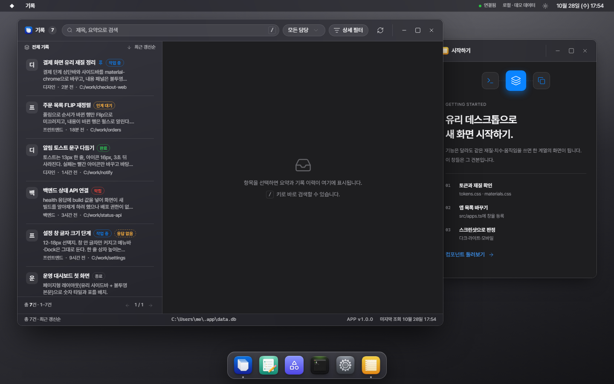
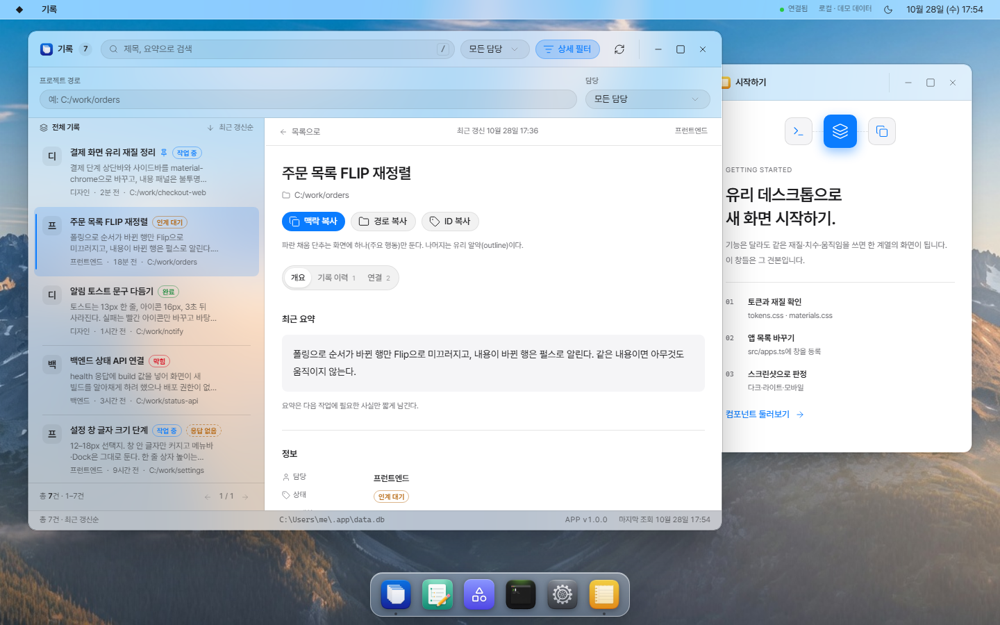
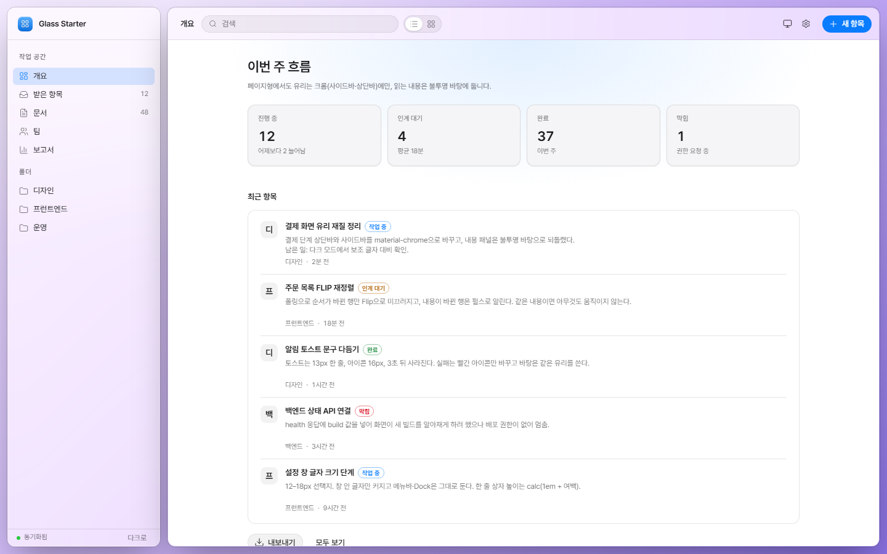
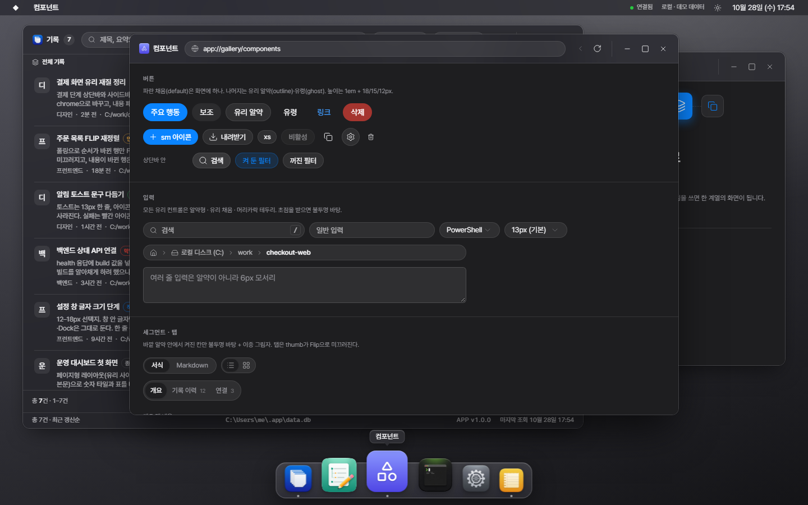

# Glass Desktop Starter Kit

Relay 웹 화면의 디자인 시스템(macOS 데스크톱 메타포 + Apple식 글래스모피즘)을 **기능과 상관없이 그대로 재사용**하려고 만든 시작 프로젝트입니다.
토큰·유리 재질·컨트롤 치수·창/메뉴바/Dock 셸·화면 패턴·모션·서체·바탕화면·아이콘 도구·디자인 판정 도구, 그리고 이 모두를 실제로 조립한 **동작하는 데모**가 들어 있습니다.

| 데스크톱형(다크) | 데스크톱형(라이트 · 상세) |
| --- | --- |
|  |  |
| **페이지형(창·Dock 없이 같은 재질)** | **컴포넌트 견본** |
|  |  |

> 모든 수치의 상세 설명은 [`reference/design_output.md`](reference/design_output.md)(Relay 디자인 시스템 전체 추출본)에 있습니다. 이 README는 **키트를 어떻게 쓰는지**를 설명합니다.
> 키트 폴더만 복사해도 되도록 상위 폴더의 `design_output.md`를 같은 내용으로 넣어 두었습니다.

---

## 목차

1. [들어 있는 것](#1-들어-있는-것)
2. [빠른 시작](#2-빠른-시작)
3. [폴더 구조](#3-폴더-구조)
4. [쓰는 방법 세 가지](#4-쓰는-방법-세-가지)
5. [디자인 원칙 한 장 요약](#5-디자인-원칙-한-장-요약)
6. [스타일 층과 주요 클래스](#6-스타일-층과-주요-클래스)
7. [데모를 걷어 내고 내 앱 만들기](#7-데모를-걷어-내고-내-앱-만들기)
8. [컴포넌트 API](#8-컴포넌트-api)
9. [모션 쓰는 법](#9-모션-쓰는-법)
10. [디자인 판정(스크린샷)](#10-디자인-판정스크린샷)
11. [맞춤 설정](#11-맞춤-설정)
12. [아이콘 만들기](#12-아이콘-만들기)
13. [함정 모음](#13-함정-모음)
14. [참고 자료](#14-참고-자료)
15. [자산 출처와 라이선스](#15-자산-출처와-라이선스)
16. [이 키트에서 확인한 것](#16-이-키트에서-확인한-것)

---

## 1. 들어 있는 것

| 구분 | 내용 | 위치 |
| --- | --- | --- |
| 디자인 토큰 | 라이트·다크 색, 선택·상태 색, 유리 재질 채움·테두리·그림자, 글자 크기·줄 높이(글자 크기 설정 연동), 모서리 | `src/styles/tokens.css`, `tokens/design-tokens.json` |
| 유리 재질 | `material-bar/dock/chrome/menu/toast/control` 6종 + 투명도 줄이기·모바일 대응 | `src/styles/materials.css` |
| 컨트롤 치수 | shadcn 프리미티브를 고치지 않고 `[data-slot]`로 알약형·높이 공식·유리 채움 적용 | `src/styles/primitives.css` |
| 데스크톱 셸 | 메뉴바·드롭다운·창(드래그·8방향 리사이즈·최소화·최대화)·창 조작·Dock(스프링 확대)·분할 경계·토스트·모바일 탭바 | `src/styles/shell.css`, `src/components/desktop/*`, `src/lib/desktop-store.ts` |
| 화면 패턴 | 목록 행·필터·배지·상세 패널·타임라인·탭·세그먼트·설정·바탕화면 견본·카드·트리·데이터 목록·아이콘 격자·미리 보기·경로 알약·빈 상태·알림 줄·서식 도구·터미널 | `src/styles/patterns.css`, `src/components/patterns/*` |
| 본문 서식 | Markdown/서식 편집 결과용 `.prose`, 문서 제목, 고정폭 원문, ProseMirror 기본 규칙 | `src/styles/prose.css` |
| 페이지형 레이아웃 | 창·Dock 없는 일반 웹앱에서 같은 재질을 쓰는 구조(유리 사이드바 + 불투명 본문) | `src/styles/page.css`, `src/demo/page-demo.tsx` |
| 모션 | GSAP 토큰·이징·헬퍼(창 열기·닫기·최소화·최대화, Flip 재정렬, 크로스페이드, 펄스, 높이 펼침 …) | `src/lib/motion.ts`, `src/components/patterns/transitions.tsx` |
| 테마·글자 크기·바탕화면 | 다크 기본, 첫 페인트 전 적용, 12–18px 글자 크기, 색상 5종·사진 4종·낮과 밤 | `src/lib/theme.ts`, `public/theme.js`, `src/lib/font-size.ts`, `src/lib/wallpaper.ts` |
| 자산 | Pretendard Variable(+OFL), 바탕화면 사진 6장, 견본 앱 아이콘 7개, 파비콘 | `public/` |
| 데모 | 기록(목록-상세)·문서(트리+서식)·컴포넌트 견본·터미널·설정·시작하기 창 + 페이지형 | `src/demo/*` |
| 도구 | 스크린샷 판정, 아이콘 후처리, 토큰 JSON 추출 | `tools/*` |
| Agent 지침 | 새 프로젝트에 넣으면 Agent가 같은 계열로 만든다 | `AGENTS.md` |
| 참고 자료 | 디자인 시스템 전체 추출본, Relay 원본 CSS·디자인 문서·모션 설계, 참고 스크린샷 41장, 아이콘 프롬프트 | `reference/` |

---

## 2. 빠른 시작

요구 사항: Node 20.19 이상 또는 22.12 이상(Vite 8 조건, Node 24에서 확인), npm.

```bash
npm install
npm run dev          # http://127.0.0.1:5173/  데스크톱형
                     # http://127.0.0.1:5173/#page  페이지형
npm run build        # tsc --noEmit + vite build → dist/
npm run preview      # 빌드 결과 미리 보기
```

데모에서 해 볼 것:

- Dock 위로 포인터를 움직이기(48→80px 스프링 확대, 라벨 하나가 미끄러짐), 닫힌 앱을 눌러 실행 바운스 보기.
- 창 상단바 끌기·두 번 누르기(최대화 Flip), 최소화(Dock으로 빨려 들어감), 모서리 끌어 크기 바꾸기.
- 기록 창: 행 고르기(강조선 + 상세 크로스페이드), 탭 바꾸기(thumb Flip), `상세 필터`(높이 펼침), 오른쪽 위 새로 고침 아이콘(Flip 재정렬 + 펄스), `/` 키(검색 초점).
- 창 폭을 900px 아래로 줄이기(목록-상세가 한 칸으로), 브라우저 폭을 760px 아래로(모바일 탭바).
- 메뉴바 왼쪽 ◆ 메뉴 → 테마·바탕화면·`페이지형 레이아웃 보기`. 설정 창에서 글자 크기 12–18px.

---

## 3. 폴더 구조

```text
starter_kit/
├─ README.md                 ← 지금 이 문서
├─ AGENTS.md                 ← 새 프로젝트에 넣을 디자인 지침(Agent용)
├─ package.json · vite.config.ts · tsconfig.json · components.json(shadcn) · index.html
├─ public/
│  ├─ theme.js               첫 페인트 전 테마 적용(깜빡임 방지, CSP 안전)
│  ├─ favicon.svg
│  ├─ fonts/                 PretendardVariable.woff2 + OFL.txt
│  ├─ wallpapers/            aurora·dunes·waves·forest(1280×720) + day·night(낮과 밤)
│  └─ icons/                 sample-*.png (256px squircle 견본 아이콘, 바꿔 쓸 것)
├─ src/
│  ├─ main.tsx               글자 크기 선적용 → TooltipProvider → App
│  ├─ App.tsx                데모 라우팅(#page) — 내 앱으로 바꿀 곳
│  ├─ apps.ts                ★ 창(앱) 등록부: 제목·아이콘·최소 크기·기본 배치. Dock 순서
│  ├─ styles/
│  │  ├─ index.css           진입점(층 순서)
│  │  ├─ tokens.css          ★ 모든 색·재질·글자 토큰(라이트/다크)
│  │  ├─ base.css            기본 규칙·초점 링·스크롤바·동작 줄이기
│  │  ├─ materials.css       유리 재질 클래스
│  │  ├─ primitives.css      shadcn [data-slot] 덮어쓰기
│  │  ├─ shell.css           바탕화면·메뉴바·메뉴·창·Dock·분할 경계·토스트·모바일
│  │  ├─ patterns.css        화면 패턴과 창 컨테이너 쿼리
│  │  ├─ prose.css           본문 서식·문서 편집 면
│  │  └─ page.css            페이지형 레이아웃
│  ├─ lib/
│  │  ├─ motion.ts           ★ 모션 토큰·헬퍼(Relay 원본 그대로)
│  │  ├─ desktop-store.ts    창 상태(zustand)·배치 저장·화면 맞춤
│  │  ├─ layout.ts           메뉴바 28 · Dock 예약 104 · 모바일 760 …
│  │  ├─ theme.ts · font-size.ts · wallpaper.ts · ui-store.ts(모양 설정 + useIsDark)
│  │  ├─ toast.ts            toast() · copyText()
│  │  └─ utils.ts            cn()
│  ├─ components/
│  │  ├─ ui/                 shadcn 프리미티브(수정 금지) + dock.tsx(Framer Motion Dock)
│  │  ├─ desktop/            Desktop · Window · WindowTitleBar · WindowControls · MenuBar · DesktopMenu · Dock · SplitView · Wallpaper · AppIcon
│  │  └─ patterns/           GlassTabs · Reveal · Placeholder/HeroEmpty · StatusBadge · Settings · Tip/CopyButton · Toaster · Appearance/WallpaperSettings · FlipList/Crossfade
│  └─ demo/                  견본 창·페이지형·가짜 데이터·demo.css(지워도 되는 부분)
├─ tools/
│  ├─ screenshot.mjs         다크·라이트·모바일 스크린샷(디자인 판정)
│  ├─ icon-postprocess.py    생성 이미지 → 256px Dock 아이콘
│  └─ export-tokens.mjs      tokens.css → tokens/design-tokens.json
├─ tokens/design-tokens.json 다른 스택용 토큰(JSON)
└─ reference/
   ├─ design_output.md      디자인 시스템 전체 추출본(상위 폴더 문서와 같은 내용)
   ├─ relay-source/          Relay 원본 styles.css · DESIGN.md · DESIGN-IMPLEMENTATION.md · desktop-design.md · motion-design.md
   ├─ screenshots/relay/     Relay 실제 화면 25장(창·메모·모바일·모션 프레임 등)
   ├─ screenshots/starter/   이 키트 데모 화면 16장
   └─ icon-prompts.md        아이콘 생성 프롬프트와 후처리 절차
```

---

## 4. 쓰는 방법 세 가지

### A. 이 키트에서 새 프로젝트를 시작한다(권장)

1. `starter_kit` 폴더를 통째로 복사해 새 저장소로 만든다(`node_modules`·`dist` 제외).
2. `package.json`의 `name`, `index.html`의 `<title>`, `src/components/desktop/app-icon.tsx`의 `BrandMark`, `public/favicon.svg`를 바꾼다.
3. `AGENTS.md`를 새 프로젝트 지침에 합친다(이미 `AGENTS.md`/`CLAUDE.md`가 있으면 「디자인 지침」 절로 붙인다).
4. `src/apps.ts`에 내 앱(창)을 등록하고, [§7](#7-데모를-걷어-내고-내-앱-만들기) 순서대로 데모를 걷어 낸다.
5. `npm run dev`로 띄우고 [§10](#10-디자인-판정스크린샷)의 스크린샷 판정을 돌린다.

### B. 기존 React + Tailwind v4 + shadcn 프로젝트에 디자인만 옮긴다

| 옮길 것 | 메모 |
| --- | --- |
| `src/styles/*` | 전역 CSS 진입점에서 `index.css`를 불러온다. 이미 `@import "tailwindcss"`가 있으면 하나만 남긴다. `source("../")`는 내 소스 폴더에 맞춘다 |
| `public/fonts`, `public/theme.js` | `index.html` `<head>`에서 `theme.js`를 스타일시트보다 **먼저** 동기 로드 |
| `src/lib/{motion,theme,font-size,ui-store,toast,utils}.ts` | `gsap`, `@gsap/react`, `zustand` 필요 |
| `src/components/patterns/*` | 필요한 것만 |
| 데스크톱 셸을 쓰면 `src/components/desktop/*`, `src/lib/{desktop-store,layout,wallpaper}.ts`, `src/apps.ts`, `public/wallpapers` | `framer-motion`, `react-resizable-panels` 필요 |
| shadcn 프리미티브 | 내 프로젝트의 `components/ui`가 `new-york` 스타일이면 그대로 둔다. `data-slot` 속성이 있어야 `primitives.css`가 먹는다 |

의존성(이 키트와 같은 버전):

```bash
npm i react@19.3.0 react-dom@19.3.0 radix-ui@1.6.7 lucide-react@1.46.0 class-variance-authority@0.7.1 clsx@2.1.1 tailwind-merge@3.7.0 \
      gsap@3.15.0 @gsap/react@2.1.2 framer-motion@14.1.0 react-resizable-panels@4.15.0 zustand@5.0.15
npm i -D tailwindcss@4.3.3 @tailwindcss/vite@4.3.3 tw-animate-css@1.4.0
```

### C. 다른 스택(Vue·Svelte·Angular·서버 렌더링·네이티브)

- **그대로 쓰는 것**: `tokens.css`, `base.css`, `materials.css`, `shell.css`, `patterns.css`, `prose.css`, `page.css`, `public/` 자산. 클래스 이름과 `data-*` 상태 속성만 맞추면 된다(예: 창 포커스 `data-focused`, 선택 `aria-selected="true"`, 세그먼트 `aria-pressed`/`aria-checked`).
- **`primitives.css`**: shadcn(`data-slot="button"` 등)을 전제로 한다. shadcn-vue처럼 `data-slot`을 쓰는 라이브러리는 그대로, 아니면 선택자를 내 컴포넌트에 맞춘다.
- **모션**: `motion.ts`는 프레임워크 독립 함수(요소를 받는다)라 그대로 쓰고, 마운트/언마운트 지점에서 부른다. CSS만으로 갈 때의 이징 대응은 `tokens/design-tokens.json`의 `motion.cssEquivalent`.
- **토큰만 필요할 때**(Figma 변수, 네이티브 앱): `tokens/design-tokens.json`(`node tools/export-tokens.mjs`로 다시 생성).

---

## 5. 디자인 원칙 한 장 요약

| 항목 | 규칙 |
| --- | --- |
| 콘셉트 | 바탕화면 위에 떠 있는 창. **크롬은 유리, 내용은 불투명** |
| 강조색 | 시스템 블루 하나(라이트 `#0a7cff` / 다크 `#0a84ff`). 파란 채움 단추는 화면에 하나 |
| 다크 기본 | `theme.js`·`theme.ts` 기본값이 다크 |
| 서체 | Pretendard Variable 13px · 400/500/600 · 자간 -0.01em · `keep-all` · 숫자 `tabular-nums` |
| 컨트롤 | 알약형(999px), 높이 `1em + 15px`(28px), 유리 채움 + 머리카락 테두리, 초점 시 불투명 |
| 모서리 | 창 12(최대화 10) · Dock 18 · 메뉴 10 · 카드 8–12 · 행 6–8 |
| 간격 | 4px 리듬 · 행 안 12 · 섹션 안 16 · 섹션 사이 24 · 좌우 여백 대칭 |
| 상태 | hover +4% · 선택 `--selected` · 초점 2px 블루 · 비활성 45% |
| 모션 | 120/160/220/260ms · 진입 power3.out · 종료 power2.in · transform/opacity만 |
| 반응 | 창 안은 컨테이너 쿼리, 뷰포트 ≤ 760px는 모바일(창 하나·탭바) |
| 판정 | 스크린샷으로 본 아름다움(다크·라이트·모바일) |

자세한 규칙과 이유는 `AGENTS.md`, 모든 수치는 `reference/design_output.md`.

---

## 6. 스타일 층과 주요 클래스

레이어 순서는 `src/styles/index.css`에 있습니다. **이 키트의 CSS는 cascade layer 밖**에 있어 Tailwind 유틸리티(`@layer utilities`)보다 강합니다. 패턴 클래스가 정한 속성은 유틸리티로 덮이지 않으니, 여백 같은 조정은 감싸는 요소에 주세요(§13).

| 파일 | 주요 클래스·선택자 |
| --- | --- |
| `tokens.css` | `--background` … `--glass-*` · `--window-*` · `--fs-*` · `--lh-*` · `--radius-control` · `--tint-*` · `--tone-*` |
| `base.css` | 본문 기본값, 초점 링, `.skip-link`, `.sr-only-text`, 동작 줄이기 |
| `materials.css` | `.material-bar` `.material-dock` `.material-chrome` `.material-menu` `.material-toast` `.material-control` |
| `primitives.css` | `[data-slot="button"][data-size]`, 입력·선택·탭 알약, Select 목록(왼쪽 체크), 툴팁(화살표 없음), 배지, 상단바 안 버튼 변형(`.window-toolbar`/`.toolbar`) |
| `shell.css` | `.desktop` `.wallpaper[data-color]` `.menubar*` `.status-dot[data-state]` `.desktop-menu` `.menu-item` `.split-handle` `.window[data-focused/maximized/minimized]` `.window-frame` `.resize-handle` `.titlebar` `.window-title` `.title-count` `.window-toolbar` `.toolbar-icons` `.window-controls` `.window-control` `.dock*` `.dock-tip` `.app-icon` `.app-tile(-box)` `.toast` `.toast-top` `.toast-inline` `.copy-fallback` 모바일 규칙 |
| `patterns.css` | 목록 `.list-panel` `.list-toolbar` `.list-rows` `.list-row[aria-selected]` `.row-accent` `.avatar` `.row-title` `.row-summary` `.row-meta` `.row-action` `.pager` `.statusbar` · 필터 `.search-field` `.kbd` `.filter-row` `.reveal` `.filter-chips` · 배지 `.status-badge[data-status]` `.stale-badge` `.quiet-badge` `.pin-mark` · 상세 `.detail-slot` `.detail-panel` `.detail-topline` `.back-link` `.detail-header` `.detail-meta` `.detail-actions` `.detail-hint` `.detail-tabs-wrap` `.detail-section` `.summary` `.hint` `.eyebrow` `.identity-grid` `.path-block` `.time-grid` `.technical-details` `.timeline` `.chain*` `.relation` `.current-card` · 탭 `.glass-tabs` `.tabs-thumb` · 세그먼트 `.segmented[data-variant=icon]` · 설정 `.settings-*` `.theme-field` `.wallpaper-picker` `.wallpaper-choice` · `.removable` `.corner-remove` · 카드 `.card-grid` `.tile-card[data-kind=folder]` `.media-grid` `.media-card` `.place-grid` `.place-card` `.place-icon[data-tone]` `.drive-card` `.drive-icon` `.meter[data-full]` · 트리 `.tree` `.tree-item` `.tree-row` `.tree-chevron` `.tree-icon` `.tree-label` `.tree-count` `.tree-more` `.tree-rename` `.sidebar-footer` · 데이터 `.data-view` `.data-columns` `.data-list` `.data-row` `.data-cell` `.item-icon[data-tone]` `.data-status` · `.icon-grid` `.icon-tile` · `.inspector*` · `.path-pill` `.crumb` · `.address-field` · 빈 상태 `.placeholder` `.hero-empty` `.empty-card` `.welcome*` `.illustration-*` · `.notice-bar` · 서식 `.format-toolbar` `.format-tool` · 터미널 `.window[data-terminal]` `.terminal-body` `.term-*` `.shell-picker` · `.spin` |
| `prose.css` | `.prose`(제목·목록·체크리스트·인용·코드·표) `.doc-title` `.source-editor` `.doc-scroll` `.doc-sheet` `.doc-body` `.ProseMirror*` |
| `page.css` | `.page-shell[data-mobile]` `.page-layout` `.page-panel` `.page-sidebar` `.page-brand` `.page-nav*` `.page-main` `.page-header` `.page-content` `.page-section` `.page-glow` `.stat-grid` `.stat-card` `.page-tabbar` |

### 창 컨테이너 쿼리 기준

`.window-frame`과 `.page-main`이 `container: win`입니다. 글자 크기와 엮인 기준은 `em`(13px 환산값).

| 조건 | 바뀌는 것 |
| --- | --- |
| ≤ 899px(`SplitView collapse`) | 목록-상세 중 한 칸만(창에 `detail`을 주면 상세) |
| ≤ 55.31em(719px) | 상단바 줄바꿈(툴바가 아랫줄), 필터 세로 쌓기, 상세 여백 16 |
| ≤ 54em(702px) | 미리 보기 패널(`.inspector`) 숨김 |
| ≤ 43em(559px) | 터미널 줄 세로 쌓기 |
| ≤ 40em(520px) | 데이터 목록 종류 열 숨김, 문서 여백 축소 |
| ≤ 39.95em(519px) | 검색 한 줄 전체·단축키 숨김, 상태바 축소, 페이지형 상단바 줄바꿈·숫자 타일 2칸 |
| ≤ 29em(377px) | 데이터 목록 날짜 열 숨김 |

---

## 7. 데모를 걷어 내고 내 앱 만들기

### 7-1. 데모 지우기

1. `src/demo/` 폴더를 지운다.
2. `src/main.tsx`에서 `import "./demo/demo.css";`를 지운다.
3. `src/App.tsx`를 내 화면으로 바꾼다(아래 예시).
4. `src/apps.ts`의 `APP_IDS`·`APPS`·`PRIMARY_APP`를 내 앱으로 바꾼다.
5. `public/icons/sample-*.png`를 내 아이콘으로 바꾸거나, 아이콘이 준비될 때까지 코드 타일(`{ glyph, from, to }`)을 쓴다.

### 7-2. 앱 등록(`src/apps.ts`)

```ts
import { Inbox, Settings } from "lucide-react";

export const APP_IDS = ["inbox", "settings"] as const;   // Dock 순서
export type AppId = (typeof APP_IDS)[number];
export const PRIMARY_APP: AppId = "inbox";                // 늘 열려 있고 맨 앞

export const APPS: Record<AppId, AppDef> = {
  inbox: { id: "inbox", title: "받은 항목", icon: { glyph: Inbox, from: "#5ab0ff", to: "#0a6fe0" }, min: { w: 640, h: 440 },
    box: (W, H) => ({ x: 40, y: 44, w: Math.min(1000, W - 80), h: Math.min(720, free(H) - 24) }), openByDefault: () => true },
  settings: { id: "settings", title: "설정", icon: { src: "/icons/settings.png" }, min: { w: 480, h: 400 },
    box: (W, H) => ({ x: centered(W, 560), y: 100, w: 560, h: Math.min(640, free(H)) }) },
};
```

배치는 `localStorage["app-desktop-v1"]`에 저장됩니다. 등록을 바꾼 뒤 이상하면 메뉴바 ◆ → `창 배치 초기화`.

### 7-3. 셸 조립(`src/App.tsx`)

```tsx
import { Desktop } from "@/components/desktop/desktop";
import { InboxWindow } from "./windows/inbox-window";
import { MySettingsWindow } from "./windows/settings-window";

export function App() {
  return <Desktop status="online" statusText="연결됨" label="로컬">
    <InboxWindow />
    <MySettingsWindow />
  </Desktop>;
}
```

창 컴포넌트는 늘 렌더해 둡니다. 열림·닫힘은 `useDesktop`이 정하고, 닫힌 창은 `Window`가 `null`을 돌려줍니다.

### 7-4. 가장 단순한 창

```tsx
import { Window } from "@/components/desktop/window";

export function AboutWindow() {
  return <Window id="about" bodyClassName="overflow-y-auto bg-background">   {/* 내용은 불투명 */}
    <div className="detail-section"><h3>정보</h3><div className="summary">…</div></div>
  </Window>;
}
```

### 7-5. 목록-상세 창 뼈대(기록 창과 같은 구조)

```tsx
<Window id="inbox" detail={Boolean(selected)} header={
  <WindowTitleBar id="inbox" count={items.length} right={<Tip text="새로 고침"><Button variant="ghost" size="icon-sm" aria-label="새로 고침"><RefreshCw /></Button></Tip>}>
    <InputGroup className="search-field"><InputGroupAddon><Search /></InputGroupAddon><InputGroupInput placeholder="검색" /></InputGroup>
    <Button size="sm" variant={open ? "secondary" : "outline"} onClick={toggle}><ListFilter />상세 필터</Button>
  </WindowTitleBar>}>
  <Reveal open={open}><div className="filter-row material-chrome">…</div></Reveal>
  <SplitView name="inbox" label="목록" collapse defaultWidth={340} minWidth={260} maxWidth={640} minMain={360}
    side={<div className="list-panel material-chrome">
      <div className="list-toolbar"><span>전체</span><span>최근순</span></div>
      <FlipList items={items} className="list-rows">{items.map((item) => <li key={item.id} className="list-row" data-flip-id={item.id} aria-selected={item.id === selected}>…</li>)}</FlipList>
    </div>}
    main={<div className="detail-slot" ref={slotRef}>
      <Crossfade swapKey={selected ?? "none"} container={slotRef} select=".detail-panel, .placeholder">
        {current ? <div className="detail-panel">…</div> : <Placeholder icon={Inbox}>항목을 고르세요.</Placeholder>}
      </Crossfade>
    </div>} />
  <div className="statusbar material-chrome"><span>총 {items.length}건</span></div>
</Window>
```

전체 예는 `src/demo/windows/library-window.tsx`.

### 7-6. 페이지형(창·Dock 없이)

```tsx
<div className="page-shell" data-mobile={mobile ? "" : undefined}>
  <Wallpaper dark={useIsDark()} />                      {/* 유리 뒤에 비칠 바탕. 지우지 않는다 */}
  <div className="page-layout">
    <aside className="page-panel page-sidebar">…<nav className="page-nav">…</nav></aside>
    <section className="page-panel page-main">
      <header className="page-header"><h1>제목</h1><div className="toolbar …">…</div></header>
      <div className="page-content page-glow"><div className="page-section">…</div></div>
    </section>
  </div>
  <Toaster />
</div>
```

전체 예는 `src/demo/page-demo.tsx`. 라우터(React Router 등)를 쓰면 `.page-content` 안만 바꿉니다.

---

## 8. 컴포넌트 API

### 데스크톱 셸(`src/components/desktop`)

| 컴포넌트 | 속성 | 하는 일 |
| --- | --- | --- |
| `Desktop` | `status?: "online"\|"pending"\|"warning"\|"offline"`, `statusText?`, `label?`, `brandItems?: MenuEntry[]`, `children` | 건너뛰기 링크·바탕화면·메뉴바·창 레이어·Dock·토스트 조립, 모바일 전환·화면 맞춤 |
| `Window` | `id`, `header?`, `bodyClassName?`, `detail?`, `terminal?`, `children` | 창 프레임, 열기·닫기·최소화·복원·최대화 전환, 8방향 리사이즈 |
| `WindowTitleBar` | `id`, `title?`, `count?`, `children?`(툴바), `right?` | 유리 상단바(드래그 손잡이, 두 번 눌러 최대화) + 창 조작 |
| `MenuBar` | `dark`, `status`, `statusText`, `label?`, `brandItems?`, `onOpenSettings?` | 브랜드 메뉴(설정·바탕화면·테마·배치 초기화)·창 메뉴·상태·테마 토글·시계 |
| `DesktopMenu` | `items`, `position`, `leaving`, `onClose`, `onExited` | body로 포털한 유리 메뉴(키보드 ↑↓ Home End Esc) |
| `Dock` | — | `APPS`로 Dock 구성, 실행 바운스·표시점·모바일 탭바 |
| `SplitView` | `name`, `label`, `side`, `main`, `defaultWidth`, `minWidth`, `maxWidth`, `minMain?`, `collapse?` | 왼쪽 폭 조절(px 유지·기억·두 번 눌러 기본값), 좁은 창 한 칸 |
| `Wallpaper` | `dark` | 토큰 그라디언트·색상·낮밤 사진·고른 사진 크로스페이드 |
| `AppIcon` / `IconArt` / `BrandMark` | `app` / `spec`, `size` | PNG 또는 코드 타일 아이콘, 메뉴바 마크 |

창 조작은 스토어로: `useDesktop.getState().open(id) / close(id) / focus(id) / minimize(id) / toggleMaximize(id) / resetLayout()`.

### 패턴(`src/components/patterns`)

| 컴포넌트·함수 | 속성 | 하는 일 |
| --- | --- | --- |
| `GlassTabs` | `value`, `onValueChange`, `tabs: { value, label, count?, content }[]` | 유리 알약 탭 + 미끄러지는 thumb |
| `Reveal` | `open` | 높이 0↔auto 펼침, 접힌 뒤 언마운트 |
| `Placeholder` | `icon`, `children`, `hint?` | 선택 없음 자리 |
| `HeroEmpty` | `art`, `title`, `children`, `actions?`, `glow?` | 광원 있는 시작 화면 |
| `StatusBadge` / `StaleBadge` / `QuietBadge` | `status` / `children` | 작업 상태·응답 없음·조용한 표시 |
| `SettingsGroup` / `SettingsRow` | `title`, `id?`, `note?` / `label`, `htmlFor?` | 설정 카드와 120px 라벨 행 |
| `AppearanceSettings` / `WallpaperSettings` | — | 테마·글자 크기 / 바탕화면 견본 격자 |
| `Tip` / `CopyButton` | `text` / `value`, `label` | 툴팁(버튼 `data-slot` 보존) / 복사 아이콘 단추 |
| `Toaster`, `toast(text, tone?)`, `copyText(text, label?)` | `tone: "success"\|"info"\|"error"` | 아래 가운데 유리 알약 토스트 |
| `FlipList` | `items`, `listKey?`, `className?` | 목록 재정렬 Flip(행에 `data-flip-id`) |
| `Crossfade` | `swapKey`, `container`, `select`, `from?`, `onEntered?` | `key` 교체 영역 크로스페이드 |

### 상태 훅

`useUI`(theme·fontSize·wallpaper + setter), `useIsDark()`, `useDesktop`(창 상태), `useToast`.

---

## 9. 모션 쓰는 법

```ts
import { MOTION, EASE, dur, enter, exit, staggerIn, pulse, expandHeight, collapseHeight, growAccent, popIn } from "@/lib/motion";
```

| 토큰 | 값 | 용도 |
| --- | --- | --- |
| `micro` | 120ms | 툴팁·칩·강조선·상태점·메뉴 닫기 |
| `fast` | 160ms | 종료, 탭 콘텐츠·thumb, 드래그 스냅 |
| `base` | 220ms | 진입, 메뉴, 토스트, 상세 교체, 재정렬, 펼침 |
| `window` | 260ms | 창 열기·최소화·복원·최대화 |
| `stagger` | 30ms(총 300ms 상한) | 목록 행 |
| `pulse` | 600ms | 갱신 하이라이트 |

이징: 진입 `power3.out` · 종료 `power2.in` · 이동/크기 `power3.inOut` · 토스트 `back.out(1.4)` · 바운스 `power1.inOut`.

규칙:

1. 새 애니메이션은 헬퍼나 `dur()`를 거친다 → `prefers-reduced-motion`에서 자동으로 0.
2. React에서는 `useGSAP(() => enter(ref.current), { dependencies: [...] })`.
3. 사라지는 것: 상태를 바로 지우지 말고 "닫는 중" 플래그 → `exit()` 끝나면 실제 제거(`Window`·`Reveal`·`Toaster` 참고). `key`로 바뀌는 영역은 `Crossfade`.
4. transform·opacity만. 드래그·리사이즈 중에는 트윈을 만들지 않는다.
5. 테스트용 관찰점은 `data-entering`·`data-pulsing`·`data-closing` 속성(전역 노출 금지).

전환 인벤토리(창 A1–A8, 목록 B1–B5, 상세 C1–C5, 메뉴·토스트 D1–D5, Dock E1–E3, 기타 F1–F5)와 감사 기준은 `reference/relay-source/motion-design.md`.

---

## 10. 디자인 판정(스크린샷)

합격 기준은 스크린샷입니다. 화면을 바꿀 때마다 찍어서 봅니다.

```bash
npm i -D playwright && npx playwright install chromium   # 한 번
npm run dev                                               # 다른 터미널
node tools/screenshot.mjs                                 # → screenshots/*.png (다크·라이트·노트북·좁은 창·모바일 2·투명도 줄이기)
node tools/screenshot.mjs http://127.0.0.1:5173/#page shots-page
```

콘솔 오류가 있으면 `✗`로 표시하고 종료 코드 1을 돌려줍니다. 비교 기준은 `reference/screenshots/relay/`(원본)와 `reference/screenshots/starter/`(이 키트).

판정표:

- [ ] 메뉴바·Dock·상단바·사이드바 뒤로 바탕화면이 비친다(회색 판 아님).
- [ ] 포커스 창이 비포커스 창보다 또렷하다(그림자·채움).
- [ ] 상단바 요소가 수직 중앙, 목록 행 높이가 일정, 좌우 여백이 대칭.
- [ ] 파란 채움 단추가 화면에 하나뿐.
- [ ] 보조 글자가 유리 위에서도 읽힌다(대비 4.5:1).
- [ ] 잘린 글자·겹침·굵은 스크롤바·한쪽으로 쏠린 글자가 없다.
- [ ] 라이트·다크 모두, 모바일(390px)에서도 위 조건을 만족한다.
- [ ] 동작 줄이기에서 움직임 없이 바로 바뀐다.

---

## 11. 맞춤 설정

| 바꾸고 싶은 것 | 고칠 곳 |
| --- | --- |
| 강조색 | `tokens.css`의 `--primary`·`--ring`·`--link`·`--selected`·`--pulse-tint`(라이트·다크 둘 다). 시스템 블루가 아니면 `--selected`도 같은 색상 16%/28%로 |
| 보조 강조(영역별) | `--tint-teal`·`--tint-folder`, 서식 막대 `--format-accent`, 본문 `--prose-accent` |
| 기본 테마 | `public/theme.js`(`dark = true`)와 `src/lib/theme.ts`(`readTheme`의 `return "dark"`)를 함께 |
| 저장 키 | `app-theme`(theme.js·theme.ts) · `app-font-size` · `app-wallpaper` · `app-desktop-v1` · `app-split-v1` — 프로젝트 이름으로 바꾸면 다른 앱과 섞이지 않는다 |
| 기본 바탕화면 | `src/lib/wallpaper.ts`의 `DEFAULT_WALLPAPER` |
| 색상 바탕화면 추가 | `shell.css`에 `.wallpaper[data-color="x"], .wallpaper-swatch[data-color="x"] { background: … }` + `wallpaper.ts`의 `COLORS` |
| 사진 바탕화면 추가 | `public/wallpapers/x.jpg`(1280×720 이상) + `PRESETS` |
| 메뉴바 높이·Dock 예약 | `tokens.css`의 `--menubar-height`와 `src/lib/layout.ts`를 함께 |
| 글자 크기 단계 | `src/lib/font-size.ts`의 `FONT_SIZES` |
| 서체 | `tokens.css`의 `@font-face`와 `--font-sans`(한글 글리프가 있는 가변 서체 권장) |
| 브라우저 제목 표시줄 색 | `src/lib/theme.ts`의 `THEME_COLOR`, `index.html`의 `theme-color` |
| 메뉴바 브랜드 메뉴 항목 | `Desktop`의 `brandItems` |

---

## 12. 아이콘 만들기

`reference/icon-prompts.md`에 생성 프롬프트(앱 아이콘·목록 아이콘)와 절차가 있습니다.

```bash
python tools/icon-postprocess.py generated.png public/icons/inbox.png          # 타일형(11–245px)
python tools/icon-postprocess.py generated.png public/icons/folder.png --shape # 타일 없는 모양(14–242px)
```

- 결과: 256px, 투명 바깥, 아래로만 떨어지는 그림자(6px · 흐림 3 · 26%), 회색 외곽선 없는 가장자리. 밝은·어두운 미리 보기 파일도 함께 만들어지니 확인 뒤 지웁니다.
- 아이콘이 없으면 코드 타일(`{ glyph: LucideIcon, from, to }`)로 시작해도 Dock·상단바에서 같은 비율(캔버스의 91%)로 보입니다.
- 그림을 바꾸면 주소에 `?v=2`처럼 판 번호를 붙여 캐시를 피합니다.

---

## 13. 함정 모음

| 증상 | 원인 | 해법 |
| --- | --- | --- |
| 유리가 회색 판처럼 보인다 | 뒤에 비칠 바탕이 없다 | `.wallpaper`를 깔고 그 위에 판을 띄운다 |
| 메뉴 유리가 뒤 창을 흐리지 못한다 | 부모(메뉴바)의 `backdrop-filter`가 backdrop 루트가 된다 | 메뉴·라벨을 `body`로 포털(`DesktopMenu`, Dock 라벨) |
| 펼침 중 안쪽 유리가 안 비친다 | 부모가 반투명이면 자식 `backdrop-filter`가 깨진다 | 불투명도는 안쪽에만(`expandHeight`) |
| 툴팁 화살표(마름모)가 글자를 덮는다 | shadcn 화살표는 회전한 정사각형(`bg-foreground`)이고 `span` 안에 있어 `[data-slot=tooltip-content] > svg` 덮어쓰기가 닿지 않는다. 반투명 유리 위에서는 겹친 자리도 두 겹으로 보인다 | 화살표를 없애고 `sideOffset` 6px(`components/ui/tooltip.tsx`, macOS 툴팁처럼) |
| 툴팁 단 버튼만 크기·모양이 다르다 | shadcn `TooltipTrigger asChild`가 `data-slot="tooltip-trigger"`를 합쳐 `data-slot="button"`을 덮는다 | `patterns/tip.tsx`의 `Tip`(Radix Trigger 직접 사용)만 쓴다 |
| `mt-4` 같은 유틸리티가 안 먹는다 | 키트 CSS는 레이어 밖이라 `@layer utilities`보다 강하다 | 패턴 클래스가 정한 속성은 감싸는 요소로 조정한다 |
| 분할 경계 틈으로 뒤 창이 비친다 | 창 바탕이 투명 + 반투명 선 | 3px 핸들(1px 선 + 2px 불투명) 그대로 쓴다 |
| 좁은 창에서 패널이 안 숨는다 | 라이브러리가 패널 바깥 요소에 인라인 `display: flex`를 준다 | `[data-panel][id$="-side"]`에 `!important`(patterns.css) |
| 크로스페이드 중 배경이 비친다 | 두 겹이 동시에 반투명 | 불투명 바탕 한 장(`captureClone`이 자동으로 깐다) |
| 줄 클램프 아래 잘린 줄이 보인다 | 클램프 상자에 padding | margin으로 여백 |
| 고정폭 칸의 한글이 넓다 | 고정폭 글꼴에 한글 없음 | 스택에 Pretendard(`.source-editor`) |
| 첫 화면이 번쩍인다 | 테마 적용이 번들 뒤 | `theme.js`를 `<head>`에서 동기 로드 |
| 테마 전환 순간 요소들이 따로 바뀐다 | transition이 색 변화에 반응 | `applyTheme`의 `data-theme-switching` |
| 값에 따라 선택 버튼 폭이 출렁인다 | 내용 폭에 맞춤 | `.min-width-label`(9.5em) |
| Dock 라벨이 깜빡인다 | 아이콘마다 라벨 | Dock에 하나만(`ui/dock.tsx`) |
| 아이콘 바꿔도 예전 그림 | 캐시 | `?v=` 판 번호 |
| 생성 아이콘에 회색 외곽선 | 반투명 가장자리를 검정과 섞음 | `tools/icon-postprocess.py` |
| 서식 막대 Select가 글자를 엇나가게 한다 | Radix Select가 닫힐 때 초점을 늦게 돌려줌 | 아이콘 단추 + `mousedown` 막기 |
| CSP에서 TipTap 스타일이 사라진다 | `style-src 'self'` | `injectCSS: false` + `prose.css`의 ProseMirror 규칙 |

---

## 14. 참고 자료

| 파일 | 내용 |
| --- | --- |
| [`reference/design_output.md`](reference/design_output.md) | Relay 디자인 시스템 전체 추출본(색·재질·타이포·치수·컴포넌트 27종·모션·반응형·테마·바탕화면·PWA·함정) |
| `reference/relay-source/styles.css` | Relay 원본 CSS 전체(이 키트 패턴의 출처, 수정 없음) |
| `reference/relay-source/DESIGN.md` · `DESIGN-IMPLEMENTATION.md` | Relay의 디자인 시스템 요약과 적용 결정 |
| `reference/relay-source/desktop-design.md` | 초기 설계: 참고 디자인 관찰값, 토큰 근거, 정렬 10원칙, 미적 합격 기준(일부 값은 이후 바뀜 — 정본은 tokens.css) |
| `reference/relay-source/motion-design.md` | 모션 설계: 전환 인벤토리·접근성 규칙·테스트 계약·감사 기준 |
| `reference/screenshots/relay/` | Relay 실제 화면(다크·라이트·상세·모바일·메모·Dock 확대·글자 18px·갱신 토스트·제목 표시줄 통합·모션 프레임 0/80/160/260ms) |
| `reference/screenshots/starter/` | 이 키트 데모 화면 |
| `reference/icon-prompts.md` | 아이콘 프롬프트·후처리 |

---

## 15. 자산 출처와 라이선스

- **Pretendard Variable**: SIL Open Font License 1.1(`public/fonts/OFL.txt`). 함께 배포해야 합니다.
- **바탕화면 사진·견본 앱 아이콘**: Relay 저장소(MIT)를 위해 이미지 생성 도구로 만든 자산입니다. Apple 저작 자산(SF Pro, macOS 배경화면·앱 아이콘)은 쓰지 않았습니다. 견본 아이콘은 내 앱 아이콘으로 바꾸는 것을 전제로 합니다.
- **shadcn/ui 프리미티브**: MIT. 원본 그대로 두되, `tooltip.tsx`만 화살표를 빼고 `sideOffset`을 6px로 바꿨습니다(§13). **Dock 컴포넌트**는 21st.dev Dock을 바탕으로 Relay에서 고친 것입니다.
- 외부 CDN·원격 폰트는 쓰지 않습니다(CSP `default-src 'self'`에서 동작).

---

## 16. 이 키트에서 확인한 것

- `npm install` → `npm run typecheck`(`tsc --noEmit`) → `npm run build`(Vite 8) 통과.
- `vite preview`로 띄워 Playwright로 다크·라이트·상세·필터 펼침·컴포넌트 견본·문서·설정·터미널+메뉴·Dock 확대·페이지형 다크/라이트·모바일(390px)·좁은 창(860px)을 찍어 눈으로 확인했고, 콘솔 오류는 없었습니다(`reference/screenshots/starter/`).
- `tools/screenshot.mjs`(7장, 오류 없음), `tools/icon-postprocess.py`(밝은·어두운 바탕에서 가장자리 확인), `tools/export-tokens.mjs`(색 49 · 재질 20 · 글자 11 토큰) 동작 확인.
- 확인하면서 고친 것: 일러스트 연결선 선택자, 격자 여백, 서식 막대 폭, 페이지형 좁은 화면 상단바, 코드 타일 Dock 확대, 툴팁 단 버튼의 `data-slot` 덮어쓰기, 툴팁 화살표가 글자를 덮는 문제(§13).
